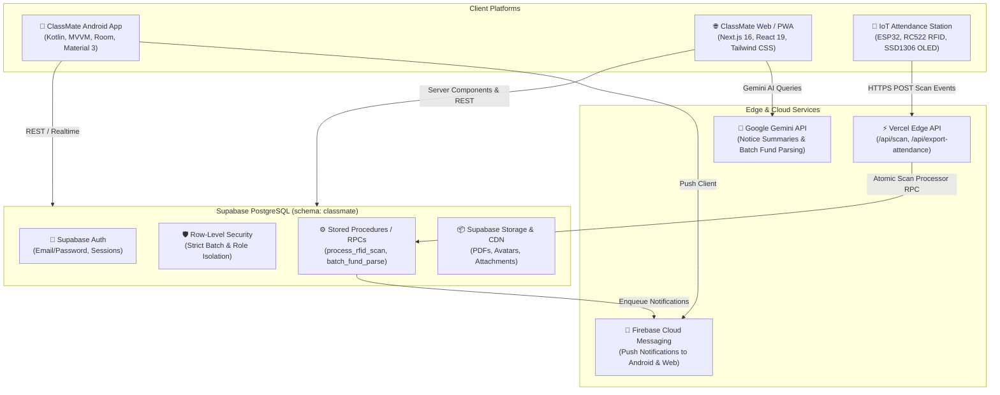

# 🎓 ClassMate

[](https://classmatebd.vercel.app)
[](app/)
[](supabase/)
[](https://github.com/shuaibuddowla/attendance-tracker)
[](LICENSE)

**ClassMate** is an all-in-one academic ecosystem designed for university batches and academic departments. Originally built for the Department of Computer Science & Engineering at Mawlana Bhashani Science and Technology University (MBSTU), it unifies **AI-powered notice feeds**, **smart timetable & campus bus schedules**, **curriculum-aligned PDF libraries**, **batch fund & student roster management**, **emergency blood donation networks**, **realtime chat & polls**, and a dedicated **physical IoT RFID attendance station** into a cohesive mobile and web experience.

---

## 📑 Table of Contents

- [Architectural Overview](#-architectural-overview)
- [Key Features](#-key-features)
  - [1. AI-Powered Notice Feeds & Summaries](#1-ai-powered-notice-feeds--summaries)
  - [2. Smart Timetable & Bus Schedules](#2-smart-timetable--bus-schedules)
  - [3. Interactive Academic Library & Document Visualizer](#3-interactive-academic-library--document-visualizer)
  - [4. Batch & Batch Fund with ClassMate AI](#4-batch--batch-fund-with-classmate-ai)
  - [5. IoT RFID & NFC Hardware Attendance Station](#5-iot-rfid--nfc-hardware-attendance-station)
  - [6. Campus Blood Donation Network](#6-campus-blood-donation-network)
  - [7. Realtime Academic Social Feed & Presence](#7-realtime-academic-social-feed--presence)
- [Tech Stack](#-tech-stack)
- [Project Directory Structure](#-project-directory-structure)
- [Self-Hosting & Deployment Guide](#-self-hosting--deployment-guide)
  - [Step 1: Database & Supabase Setup](#step-1-database--supabase-setup)
  - [Step 2: Web App Deployment (Vercel)](#step-2-web-app-deployment-vercel)
  - [Step 3: Android App Build (Android Studio)](#step-3-android-app-build-android-studio)
  - [Step 4: IoT Hardware Attendance Station Setup](#step-4-iot-hardware-attendance-station-setup)
- [Security & Secrets Hygiene](#-security--secrets-hygiene)
- [Contributing & License](#-contributing--license)

---

## 🏛 Architectural Overview



---

## 🚀 Key Features

### 1. AI-Powered Notice Feeds & Summaries
- **Instant AI Summarization**: Google Gemini generates concise student summaries highlighting dates, deadlines, room numbers, and mandatory instructions.
- **Rich Interactive Content**: Native markdown rendering, clickable URLs, attachments, comments, emoji reactions, and read receipts.
- **Push Alerts**: Instant background notifications for urgent academic updates, class cancellations, and substitute routines.

### 2. Smart Timetable & Bus Schedules
- **Dual Segmented Controller**: Effortlessly toggle between **Class Routine** and **Bus Schedule**.
- **Context-Aware Class Tracker**: Highlights the ongoing class, countdown timer to the next lecture, assigned room, and course teacher.
- **Campus Bus Logistics**: Live schedule with directional routes (Campus to City / City to Campus) and departure intervals.

### 3. Interactive Academic Library & Document Visualizer
- **Curriculum Hierarchy**: Subject-wise folder navigation organized by academic year, semester, and course code.
- **Option 2 Visualizer**: Full-screen, responsive PDF and document viewer with breadcrumb navigation and instant preview.
- **Offline Access**: Android Room cache enables downloaded files to remain accessible offline without internet connectivity.

### 4. Batch & Batch Fund with ClassMate AI
- **Segmented Batch View**: Seamlessly switch between **Batchmates Roster** and **Batch Fund Ledger**.
- **AI-Powered Natural Expense Parsing**: Paste raw mess or CR transaction summaries (e.g., `mehedi-100, 05-200, shuaib-500`) — ClassMate AI matches nicknames, rolls, and informal names directly to verified student profiles.
- **Multi-Channel Financial Tracking**: Real-time balances across Cash, bKash, and Nagad with complete transaction receipts.

### 5. IoT RFID & NFC Hardware Attendance Station
- **Hardware Integration**: Companion ESP32 station with RC522 13.56 MHz RFID reader, SSD1306 OLED, buzzer, and dual LEDs (see [attendance-tracker repo](https://github.com/shuaibuddowla/attendance-tracker)).
- **Live Classroom Marquee**: OLED automatically wakes upon active session creation to scroll course code and title (`CSE 2114 - Software Development Project`).
- **Strict Batch Verification**: Hardware taps are verified against enrolled student cards with automatic duplicate debounce and instant confirmation push notifications.

### 6. Campus Blood Donation Network
- **Donor Registry**: Filter batch and campus donors by blood group (A+, B+, O+, AB+, etc.), availability status, and location.
- **Emergency Broadcasts**: Send one-click urgent blood request notifications across the department with direct calling and WhatsApp links.

### 7. Realtime Academic Social Feed & Presence
- **Student Chat & Community Polls**: Realtime discussion channels, interactive polls with percentage breakdowns, and live active presence indicators.

---

## 🛠 Tech Stack

| Domain | Technologies |
| :--- | :--- |
| **Android Application** | Kotlin, Jetpack Compose, MVVM Architecture, Room Database, Material 3, Retrofit, Coroutines & Flow, WorkManager |
| **Web Frontend** | Next.js 16 (App Router), React 19, TypeScript, Tailwind CSS, Lucide Icons, Web Push API |
| **Backend & Database** | Supabase (PostgreSQL 15), Schema-isolated (`classmate`), Row Level Security (RLS), PL/pgSQL Stored Procedures, Deno Edge Functions |
| **AI & Intelligence** | Google Gemini API (gemini-2.5-flash / gemini-1.5-pro) |
| **Notifications** | Firebase Cloud Messaging (FCM), Service Worker Web Push |
| **IoT Hardware** | ESP32 DevKit V1, MFRC522 RFID, SSD1306 OLED (I2C), C++ / Arduino Framework |

---

## 📁 Project Directory Structure

```text
ClassMate/
├── app/                        # Android Native Application (Kotlin)
│   ├── src/main/java/          # Activities, ViewModels, Repositories, Adapters
│   └── src/main/res/           # Layouts, drawables, strings, navigation graphs
├── web/                        # Next.js 16 Web Application
│   ├── src/app/                # App router pages & API routes (/api/scan, /api/export-attendance)
│   ├── src/components/         # React UI components (notices, routine, library, batch-fund)
│   └── src/lib/                # Supabase client, auth helpers, push notification clients
├── supabase/                   # Supabase Database & Backend
│   ├── migrations/             # Full PostgreSQL migrations (DDL, RLS policies, RPC functions)
│   └── functions/              # Deno Edge Functions (classmate-ai, notifications, exports)
├── scripts/                    # DevOps, administration, and database migration utilities
└── README.md                   # Documentation & setup guide
```

---

## 🚀 Self-Hosting & Deployment Guide

Follow this guide to deploy your own private or institutional instance of ClassMate.

### Prerequisites
- [Supabase Account](https://supabase.com) (Free or Pro tier)
- [Vercel Account](https://vercel.com) (For hosting the web application)
- [Google AI Studio Account](https://aistudio.google.com) (For free Gemini API key)
- [Firebase Console Project](https://console.firebase.google.com) (For push notifications)
- [Android Studio Ladybug or newer](https://developer.android.com/studio) (With JDK 17)

---

### Step 1: Database & Supabase Setup

1. Create a new project on [Supabase](https://supabase.com).
2. Go to **Project Settings → API** and note down:
   - **Project URL** (`https://<project-ref>.supabase.co`)
   - **anon / public key**
   - **service_role key** (Keep this private!)
3. Apply the database migrations in [`supabase/migrations/`](supabase/migrations/):
   - You can run the SQL files in order via the **Supabase SQL Editor**, or use the Supabase CLI:
     ```bash
     supabase login
     supabase link --project-ref your-project-ref
     supabase db push
     ```
4. Configure Supabase Storage:
   - Create public buckets: `classmate-resources` (for PDF documents) and `classmate-avatars` (for student photos).

---

### Step 2: Web App Deployment (Vercel)

1. Fork or push your copy of ClassMate to GitHub.
2. In [Vercel](https://vercel.com), import your repository and set the **Root Directory** to `web`.
3. In **Environment Variables**, add:
   ```env
   NEXT_PUBLIC_SUPABASE_URL=https://your-project-ref.supabase.co
   NEXT_PUBLIC_SUPABASE_ANON_KEY=your-supabase-anon-key
   SUPABASE_SERVICE_ROLE_KEY=your-supabase-service-role-key
   GEMINI_API_KEY=your-google-gemini-api-key
   ```
4. Click **Deploy**. Vercel will build the Next.js application and deploy it globally.
5. Once deployed, your web dashboard is live at `https://your-app.vercel.app`.

---

### Step 3: Android App Build (Android Studio)

1. Open the root `ClassMate-main` directory in **Android Studio**.
2. Set up Firebase:
   - In the [Firebase Console](https://console.firebase.google.com), register an Android app with package name `com.shuaib.classmate`.
   - Download `google-services.json` and place it in the [`app/`](app/) directory:
     ```text
     app/google-services.json
     ```
3. Configure `local.properties`:
   - Create or edit `local.properties` in the project root:
     ```properties
     SUPABASE_URL=https://your-project-ref.supabase.co
     SUPABASE_ANON_KEY=your-supabase-anon-key
     ```
4. Build the Debug or Signed Release APK:
   ```powershell
   # Build Debug APK
   .\gradlew.bat assembleDebug

   # Output location:
   # app/build/outputs/apk/debug/app-debug.apk
   ```

---

### Step 4: IoT Hardware Attendance Station Setup

To assemble the physical RFID attendance reader:

1. Obtain an **ESP32 DevKit V1** and an **RC522 RFID module** (or PN532).
2. Wire the components according to the [Hardware Wiring Guide](https://github.com/shuaibuddowla/attendance-tracker/blob/main/firmware/WIRING_GUIDE.md).
3. Clone the companion firmware repo:
   ```bash
   git clone https://github.com/shuaibuddowla/attendance-tracker.git
   ```
4. Open `firmware/esp32_rfid_attendance/esp32_rfid_attendance.ino` in Arduino IDE.
5. Set your local 2.4 GHz Wi-Fi credentials and your Vercel deployment URL:
   ```cpp
   const char* WIFI_SSID     = "YOUR_2_4_GHZ_WIFI";
   const char* WIFI_PASSWORD = "YOUR_WIFI_PASSWORD";
   const char* SERVER_URL    = "https://your-app.vercel.app/api/scan";
   const char* DEVICE_ID     = "ESP32-READER-01";
   ```
6. Flash the ESP32. Tapping any registered RFID card will instantly mark attendance in ClassMate!

---

## 🔒 Security & Secrets Hygiene

To safeguard your private deployment and protect institutional data:

- **Never Commit Secrets**:
  - Keep `.env.local`, `keystore.properties`, `service-account*.json`, and private release keystores (`*.jks`) in `.gitignore`.
- **Key Roles Separation**:
  - `NEXT_PUBLIC_SUPABASE_ANON_KEY` is safe for browser and Android client distribution; its actions are constrained by PostgreSQL Row Level Security (RLS).
  - `SUPABASE_SERVICE_ROLE_KEY` bypasses RLS and must **only** reside in server-side Vercel Environment Variables or Deno Edge Function secrets. Never embed it inside the Android client app!
- **Cryptographic Hardware Scans**:
  - The `/api/scan` webhook enforces device verification, active session validation, and strict batch matching before updating attendance logs.

---

## 🤝 Contributing & License

Contributions, bug reports, and pull requests are warmly welcomed!

Distributed under the **MIT License**. Built with pride for **Mawlana Bhashani Science and Technology University (MBSTU)**.
