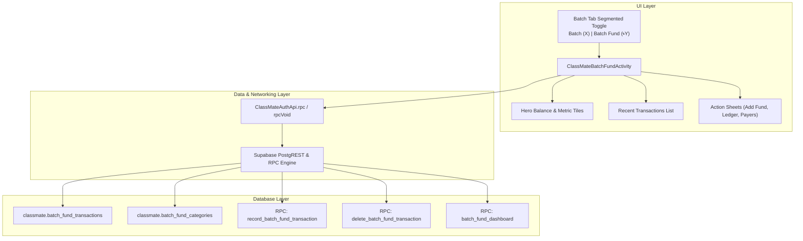
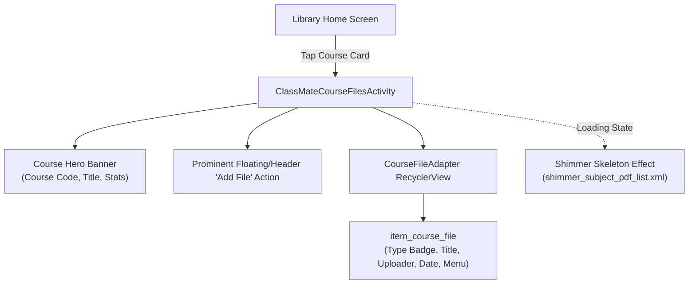
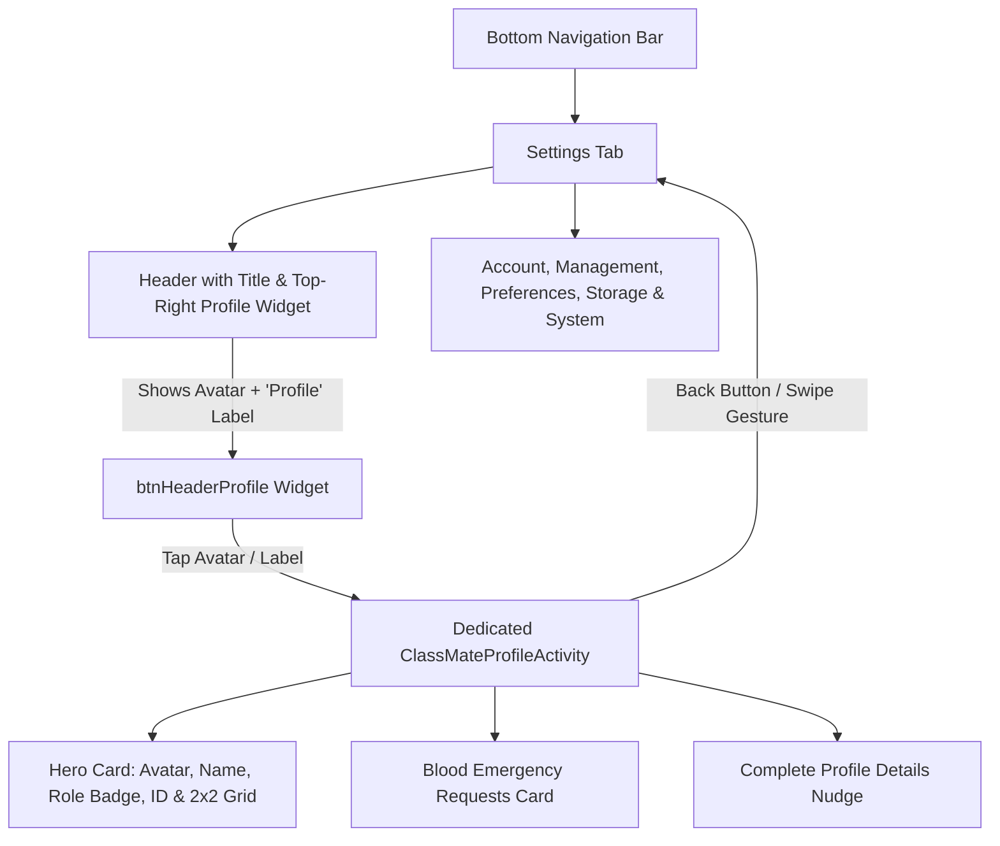
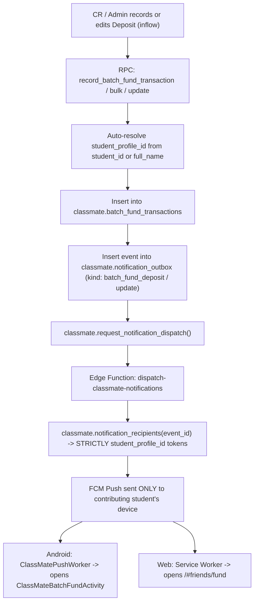
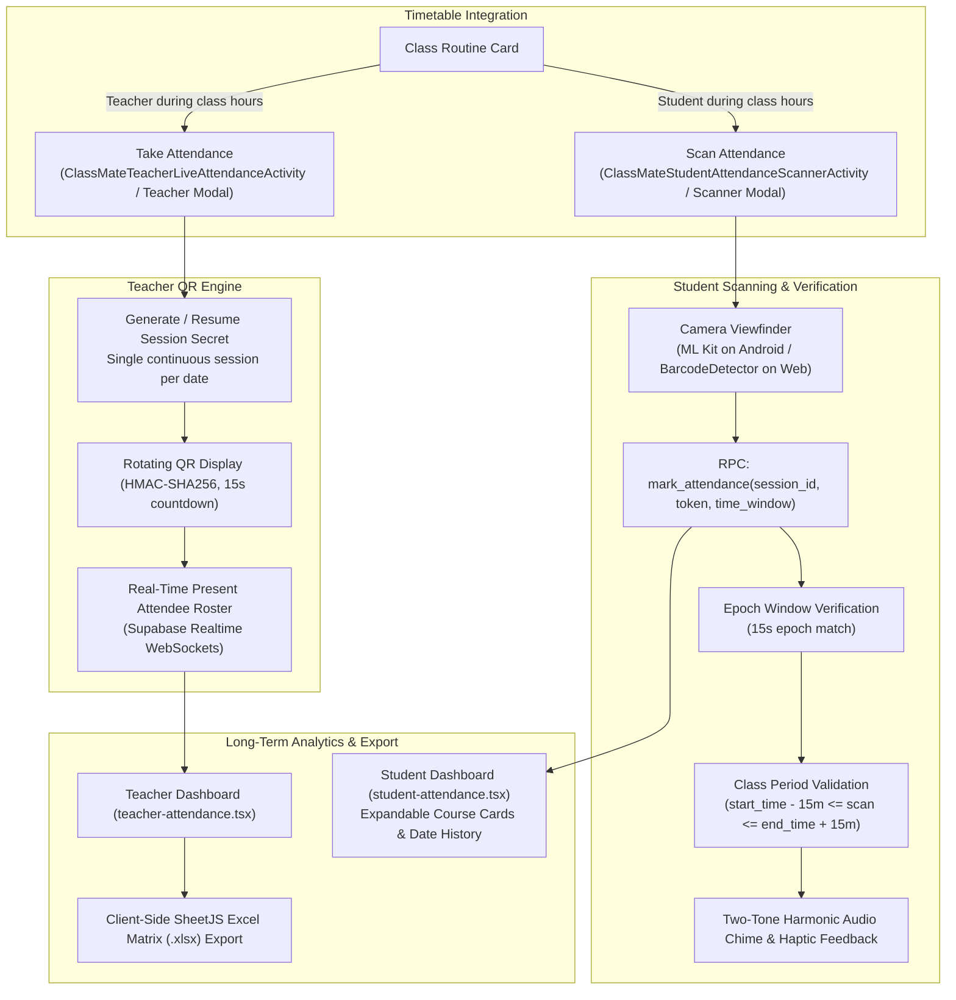

# ClassMate Platform & Android APK — Complete Architecture, Memory & Debugging Reference

This memory file serves as the definitive engineering knowledge base and memory reference for the ClassMate Android APK project, Web companion client, and Supabase backend. It documents architecture, design tokens, data models, recent features, debugging resolutions, and implementation guidelines across all modules.

---

## 1. High-Level Overview & Core Concepts

- **Purpose**: The Notice page/feed is the central academic broadcasting and engagement hub in ClassMate. It delivers announcements, class cancellations, resources/file attachments, exam notices, and deadlines to students and faculty.
- **Dual Architecture**:
  1. **Modern Supabase Academic Screens** (`ClassMateAcademicScreensSupabase.kt`): The active, production architecture powering ClassMate 1.1.23+ with smooth ListAdapter paging, real avatars, threaded comments, read receipts, and AI compose.
  2. **Legacy / Complementary Components** (`NoticeFragment.kt`, `NoticeAdapter.kt`, `NoticeRepository.kt`, Room DB `NoticeDao.kt`, Firestore): Kept for offline caching, hybrid fallbacks, and backward compatibility.
- **Web App Parity** (`web/src/components/notices.tsx`, `notice-comments.tsx`): Full functional parity with Android — responsive mobile feed and persistent desktop right-hand rail, real avatars, reaction toggles, keyset paging, translation, and reader dialogs.

---

## 2. Notice Types, Context Art & Presentation

Every notice card is visually distinct based on its classification:
- **General Notice**:
  - Background: `bg_notice_premium_general` (light gray/subtle surface)
  - Icon: Megaphone art (`ic_notice_megaphone_art`), tinted `cm_notice_premium_general` (`#4F46E5` / purple-blue)
  - Accent line: `bg_notice_premium_accent` / `cm_notice_premium_general`
- **Class Cancellation**:
  - Detected by: `class_change_id != null` or title containing cancellation keywords (`Class cancelled`, `cancellation`, etc.)
  - Background: `bg_notice_premium_cancel` (soft red/coral tint)
  - Icon: Calendar with cross art (`ic_notice_calendar_cancel_art`), tinted `cm_notice_premium_cancel` (`#DC2626` / red)
  - Dynamic Effect: Automatically links to `class_changes` in Supabase; affected periods in the Timetable turn red with `CANCELLED` badge instead of `CLASS`/`LAB`.
- **Resource / Protected File**:
  - Detected by: `resource_id != null` or title prefixed with `Resource: `
  - Background: `bg_notice_premium_resource` (soft emerald/teal tint)
  - Icon: Document/book illustration (`ic_notice_resource_art`), tinted `cm_notice_premium_resource` (`#059669` / green)
  - Attachment Card: Shows `tvFileName`, `tvFileSize` ("Tap to open protected file"), `tvFileExtension` ("FILE"), and opens via secure signed R2 URL (`openFile`).
- **No Extraneous Badges**:
  - No artificial status pills (like "Important", "Urgent", or "Exam" pills) are rendered inside modern cards; titles themselves can contain emphasis.

---

## 3. Card UI Layout & Performance Architecture (Android)

### Performance & Scrolling (`ClassMateNoticeRows.kt`)
- Implemented as an immutable **`ListAdapter<ClassMateNoticeRow, ClassMateNoticeRows.Holder>`** using `DiffUtil.ItemCallback`.
- **Row Signatures**: Each card has a unique composite signature string (`signature`) containing item data, read counts, engagement state, reader preview fingerprint, translation status, search query, and user role.
- **Granular Diffing**: When likes, read counts, or search queries change, only the affected row invalidates. The entire adapter is never reset, eliminating scroll jumps, flickering, and dropped frames.
- **View Retention**: ViewHolders and Glide image requests are preserved during paging updates.
- **State Restoration**: `stateRestorationPolicy = StateRestorationPolicy.PREVENT_WHEN_EMPTY`.

### Text Rendering & Inline Expansion (`ClassMateNoticeText.kt`)
- **Search Highlighting**: Matches are highlighted using `BackgroundColorSpan(cm_search_highlight)` (bright yellow) and `ForegroundColorSpan(cm_search_highlight_text)`.
- **URL Linkification & Precision Hit-Testing**: `Linkify.addLinks(..., Linkify.WEB_URLS)` makes web URLs clickable. `findClickableSpanUnderTouch` verifies line horizontal and vertical bounds (`x >= layout.getLineLeft(line)` and `x <= layout.getLineRight(line)`) before triggering `onClick` and consuming the touch. URLs open cleanly without triggering card ripples or false expansion toggles.
- **1200-Character Layout Bound**: Cards clamp preview string length to `minOf(body.length, 1200)` before calculating `StaticLayout`, preventing multi-thousand character rendering slowdowns while supporting 6-line previews.
- **Unicode Safety**: High-surrogate boundaries are respected (`Character.isHighSurrogate(body[end - 1])`) to prevent emoji truncation crashes.
- **6-Line Truncation & Lowercase "… see more"**:
  - Truncates at up to 6 lines (instead of 3).
  - Strictly appends `"… see more"` only if the text overflows 6 lines; shorter text ($\le 6$ lines) displays completely without any button.
  - Tapping `"… see more"` or tapping the notice title (only when expandable) expands the card inline directly in the feed.
- **Inline Expansion & Lowercase "see less"**:
  - Eliminates separate popup modals for viewing notices.
  - Short notices ($\le 6$ lines) are guarded by `isExpandable(body)`: clicking title does not toggle expand, and `"  see less"` is never appended.
  - When genuinely overflowing text is expanded, shows full text and appends an inline `"  see less"` clickable span to collapse back smoothly.
  - Card root click listener is removed (`cardRoot.isClickable = false`), avoiding unwanted card-wide tap animations.
- **Click & Hold (Long-Press) to Copy**:
  - Custom `setupCollisionFreeTouch` detects touch hold (>= 400ms), triggers native haptic vibration (`HapticFeedbackConstants.LONG_PRESS`), copies `"$title\n\n$body"` to clipboard, and shows a `"Notice copied"` toast.
  - Link collision protection: if long-pressed over a URL or expand button, the link click is canceled so the browser is not opened.
  - Suppresses teardrop cursor handles and text selection popups (`movementMethod = null`, transparent highlight).

### Notice Summary Row (`item_notice_summary.xml`)
- Rendered at the top of the feed (position 0 when active).
- Displays the most recent author's avatar (`ivSummaryAvatar`), name (`tvSummaryName`), total update count, and latest post date (`tvSummaryMeta`).

### Modern Notice Card Header & Body (`item_notice_modern.xml`)
- `noticeAccent`: 3dp colored vertical indicator matching the notice type.
- `tvTitle`: Bold 18sp title, expands to full lines when card is expanded. Tapping toggles inline expand/collapse only when expandable; holding copies notice.
- `ivNoticeIllustration`: Megaphone, calendar cancellation, or resource art.
- `btnOptions`: 3-dot management button (`ic_more_vert`). Only enabled/opaque (alpha 1f) for owner, CR, or the notice's author. Opens action dialog with "Edit title and message" and "Delete notice".
- `tvPreview`: Truncated 6-line body with inline expand/collapse and long-press copy support.
- `tvMeta`: Date formatted with calendar clock outline icon (`ic_notice_date_small`).
- `btnTranslate`: Constrained rounded ripple mask (`bg_btn_translate.xml`) with small language icon (`ic_translate_small`) + "Translate" / "Original". Eliminates giant circular bubble, matching web UX.

### Card Footer Actions (`item_notice_modern.xml`)
1. **Notice Reminder (`btnReminder`, `ivReminderIcon`)**:
   - Bell outline (`ic_notice_reminder_outline`, muted) or active bell (`ic_notice_reminder_active`, tinted `cm_primary`).
   - Tapping opens reminder options: "In 1 minute", "In one hour", "Tomorrow at 9 AM", "Clear reminder".
   - Scheduled via `ClassMateNoticeReminderScheduler` (uses `AlarmManager.setExactAndAllowWhileIdle` and fallback `ClassMateNoticeReminderWorker`).
2. **Seen / Read Receipts (`btnReadReceipts`, `tvReadCount`, `seenAvatars`)**:
   - Overlapping reader avatars: CircleImageViews showing up to 4 real reader avatars (22x22 dp, marginStart offset = index * 14 dp, 1dp border).
   - Label: `X seen` (compact formatted: `1.2k`, `3.5m`).
   - Tapping opens the **Seen by** Dialog: Displays list of students who read the notice, with names, avatars, read timestamps, and **50-reader keyset pagination** ("Load more" via `notice_readers_page`).
3. **Idle Scroll Read Tracking (`markVisibleNoticesRead`)**:
   - Monitored on `RecyclerView.SCROLL_STATE_IDLE`.
   - Checks visible items where at least 50% of the card height is visible inside the RecyclerView bounds.
   - Debounces notice IDs into a local `noticeReadSent` set to prevent duplicate RPC calls.
   - Calls Supabase RPC `mark_notices_read(target_ids)`. Optimistically prepends user's avatar and increments seen count.
4. **Like Button (`btnLike`, `ivLikeIcon`, `tvLikeCount`)**:
   - Heart outline (`ic_heart_outline`) or filled (`ic_heart_filled`, tinted red `cm_notice_like`).
   - Optimistic toggle with debounced RPC update to `notice_reactions`.
5. **Comments Button (`btnComment`, `tvCommentCount`)**:
   - Chat bubble icon (`ic_comment_outline`) with comment count.
   - Tapping opens the threaded social comments modal / bottom sheet.

---

## 4. Social Comments System

- **Backend Table**: `classmate.notice_comments` (with `id`, `notice_id`, `author_id`, `parent_id`, `body`, `client_request`, `created_at`, `updated_at`, `deleted_at`).
- **Likes on Comments**: `classmate.comment_likes` (table linking `comment_id` and `profile_id`).
- **Features**:
  - **Threaded Replies**: Root comments (`parent_id = null`) and nested replies (`parent_id = root.id`).
  - **Keyset Pagination**: RPC `comment_page(target_notice, target_parent, before_time, before_id)` fetches 50 items per page sorted by `created_at DESC, id DESC`.
  - **Idempotency**: Unique constraint on `(author_id, client_request)` using client-generated UUID prevents duplicate posts on network retry.
  - **Soft Deletion**: `delete_notice_comment(target_id)` sets `deleted_at = now()` and soft-deletes child replies. Allowed only for comment author or app owner.
  - **In-place Editing**: `save_notice_comment` updates existing comment text (enforces max 2,000 characters).

---

## 5. Web Notice Page Architecture (`web/src/components/notices.tsx`)

- **Dual-Mode Rendering**:
  - Mobile: Full dedicated screen accessible via bottom navigation.
  - Desktop: Persistent, resizable right-hand sidebar rail (`NoticeRail`) alongside the schedule workspace.
- **Infinite Query (`useInfiniteQuery`)**:
  - Key: `[ctx.user, ctx.batch, "notices"]`.
  - 10 notices per page using keyset pagination: `published_at < cursor.published_at OR (published_at = cursor.published_at AND id < cursor.id)`.
  - Calls RPC `notice_feed_details` for each page to retrieve bulk engagement, reads, author profiles, and 4-avatar previews.
  - Auto-refreshes every 30 seconds when tab is active.
- **Intersection Observer**:
  - Automatically loads the next 10 notices when scrolling near the bottom `paging` sentinel.
- **Offline Resilience**:
  - Syncs pages to `localStorage` via `saveAcademic` / `readAcademic`. If offline, loads cached pages seamlessly.
- **Instant Search**:
  - Search input filters currently loaded notices with instant highlighted marks (`<mark>`).
- **Bengali Translation**:
  - Calls Edge Function `classmate-ai` with `mode: "translate"`.
  - Translates title and body to Bengali; button toggles between "Translate" and "Show original".

---

## 6. Notice Posting & AI Compose

### Posting Channels:
1. **Web (`NoticeComposer`)**:
   - Accessible to Owner, active Batch CR, or Teacher assigned to a course.
   - Tabs:
     - **AI compose** (Default for Owner and CR): Natural language messy input (English or Bengali). AI parses course, dates, and intent.
     - **General notice**: Title, message, course picker (if teacher without general post rights).
     - **Class cancellation**: Course picker, day selector (Today or Tomorrow).
2. **Android (`PostNoticeActivity.kt`)**:
   - Segments:
     - Normal Notice / AI Posting Mode.
     - Class Cancellation (prompts course and date picker).
     - Vacation / Notice details.
     - Image & PDF Attachment picker (validates image type JPG/PNG/WebP, max 10MB).
   - Polishing with AI: `AIService.analyzeAndPolishNotice` cleans up messy drafts and suggests subject/type.

### The `/silent` Directive
- Typing `/silent` at the beginning of a notice title or body:
  - Database trigger `normalize_silent_notice` strips the `/silent` keyword and sets `silent = true` in `classmate.notices`.
  - Trigger `enqueue_notice()` checks `if new.silent then return new; end if;`.
  - **Effect**: Notice is published directly into the feed, but **no push notifications (FCM or Web Push)** are dispatched into `notification_outbox`.

---

## 7. Role & Authorization Rules

| Role | Reading Feed | Posting Permissions | Special Rules |
| :--- | :--- | :--- | :--- |
| **Student** | Reads batch notices | None | Can like, comment, seen, bookmark, translate |
| **CR (Class Rep)** | Reads batch notices | Can post general notices & cancellations to their assigned batch | Scoped strictly to their own batch (`cr_batch_id == batch_id`) |
| **Teacher** | **Only sees their own posted notices** (`author_id = teacher_id`) | Can post notices for courses they are assigned to | No student unread badges or onboarding prompts |
| **Admin / Owner** | Reads all batches | Can post anywhere, edit/delete any notice, bypass restrictions | Full system oversight |

---

## 8. Backend RPC & Database Schema Reference

### Core Table: `classmate.notices`
- `id` (uuid, PK)
- `department_id` (uuid, FK)
- `batch_id` (uuid, FK)
- `semester_course_id` (uuid, FK, nullable)
- `author_id` (uuid, FK `classmate.profiles`)
- `resource_id` (uuid, FK `file_metadata`, nullable)
- `class_change_id` (uuid, FK `class_changes`, nullable)
- `title` (text, not null)
- `body` (text, not null default '')
- `published_at` (timestamptz, default now())
- `silent` (boolean, default false)

### Key Database RPCs:
- `post_notice(target_batch, target_course, notice_title, notice_body)`: Creates notice and queues notification outbox.
- `post_cancellation_notice(target_batch, target_course, change_date)`: Creates both `class_changes` record and cancellation notice.
- `edit_notice(target_id, target_title, target_body)`: Updates title/body; preserves author permissions.
- `delete_notice(target_id)`: Removes notice and associated comments/reactions.
- `notice_feed_details(target_ids)`: Materialized batch query returning JSON with:
  - `engagement`: `like_count`, `comment_count`, `is_liked`, `is_pinned`, `reminder_at`
  - `authors`: `author_name`, `avatar_url`
  - `reads`: `read_count`, `read_by_me`
  - `previews`: Top 4 reader profiles (`profile_id`, `reader_name`, `avatar_url`, `read_at`)
- `mark_notices_read(target_ids)`: Inserts rows into `classmate.notice_reads`.
- `notice_readers_page(target_notice, before_time, before_id, page_size)`: Keyset pagination for reader list dialog (default 50).
- `comment_page(target_notice, target_parent, before_time, before_id)`: 50-item keyset pagination for threaded comments.
- `save_notice_comment(...)`, `delete_notice_comment(...)`, `set_comment_like(...)`.

---

## 10. Notice Badges, Admin Privacy & Instant UI Mechanics (New Architecture)

### A. Notice Tab Unread Badge Behavior
- **Trigger**: The notices tab icon badge in bottom navigation (`GlassBottomNavView` / `ClassMateUnreadActivity`) only displays when there is at least one published notice in the user's batch that has **not** been read by the user.
- **Immediate Dismissal**: As soon as the user opens the notices tab and views visible notices (or scrolls through all unread notices), `markVisibleNoticesRead` invokes `onNoticeRead()`.
- **0ms Badge Clearing**: `ClassMateUnreadActivity.clearNoticeBadge()` is immediately executed to clear the badge locally without awaiting a network roundtrip, followed by background synchronization.

### B. Admin Read Receipts Privacy Toggle
- **Database & Preferences**: Controlled by `owner_preferences.read_receipts_enabled` (backed by `AppPreferences.isNoticeReadReceiptsEnabled()` on Android and query `owner-preferences` on Web).
- **Backend Enforced Privacy** (`supabase/migrations/202610070002_notice_badge_and_admin_privacy.sql`):
  - When an admin has turned off read receipts (`read_receipts_enabled = false`):
    - `mark_notices_read` still records the read in `classmate.notice_reads` so the admin's personal `unread_activity` accurately drops to 0 (clearing their badge).
    - However, `notice_feed_details`, `notice_reader_previews`, and `notice_readers_page` explicitly filter out any reader whose profile is an admin owner with `read_receipts_enabled = false`.
    - The public `read_count` excludes reads by admins who opted out.
- **Client-Side Enforced Privacy**:
  - Android: `bindSeenAvatar` and `showNoticeReadReceipts` filter out the admin's profile if `profile().optString("role") == "admin" && !appPrefs.isNoticeReadReceiptsEnabled()`.
  - Web: `NoticeCard` (avatar preview list) and `ReaderList` modal filter out the admin profile when `ctx.owner && receiptsEnabled.data === false`.

### C. Instant 0ms Optimistic Notice Posting
- **Android**: `ClassMatePublishActivity` passes the newly created notice JSON back in `result.data.getStringExtra("created_notice")` with `RESULT_OK`. `ClassMateAuthActivity` retrieves it and invokes `academicScreens.onNoticeCreated(json)`, which immediately prepends the notice to `noticeFeed`, updates the local cache, and renders the feed in 0ms without full-screen loading spinners.
- **Web**: `NoticeComposer` returns the created notice from `post_notice` / `post_cancellation_notice`. The `done(created)` callback prepends it directly to TanStack Query's infinite query cache (`pages[0].entries`) and invalidates queries in the background.

### D. Instant Read Receipts & Initial Layout Marking
- **Initial Layout Trigger**: When opening the notices tab, `markVisibleNoticesRead` is triggered via `list.post` on initial layout or if `list.height == 0`, ensuring notices visible upon opening are marked as read without requiring user scrolling.
- **Optimistic State**: Read counts and avatars update in-memory (`noticeReadCounts`, `noticeReaderPreviews`) and cache immediately upon view.

---

## 11. Premium Facebook-Style Comment System Architecture

### A. Core UX & Modal Design
- **Separate Popup Layout**:
  - **Android**: Displays as an interactive `BottomSheetDialog` using `R.style.Theme_ClassMate_BottomSheetDialog` (with `WRAP_CONTENT` / peek behavior and soft top rounded corners). Contains a drag handle, pinned header with notice title and comment count pill, and an `OnBackPressedCallback` / close cross.
  - **Web**: Modern Facebook modal overlay (`.comments-modal-shell`, `.comments-modal-container`, `max-w-2xl`) with backdrop blur, pinned header, scrollable body (`.comments-body-scroll`), and sticky bottom composer.
- **Visual Facebook Aesthetics**:
  - **Speech Bubble Design**: Comments and replies are encased in distinct bubble backgrounds (`bg_comment_bubble.xml` with `#F1F5F9` surface, soft borders, and 18dp corner radii).
  - **Author Badges**: Notice authors have a distinct visual badge ("Author" / "Admin") rendered beside their name in both parent comments and replies.
  - **Engagement Row**: Directly below each bubble is a compact engagement row featuring timestamp, `Like` button with optimistic count increment, `Reply` button, and context menu trigger.
  - **Floating Heart / Like Counter**: Active likes display a floating heart counter badge (`❤️ count`) positioned on the comment bubble.

### B. Compact Bottom Composer System
- **Size & Layout**:
  - Engineered with a compact capsule design (`bg_comment_input_capsule.xml` on Android, `.comment-sticky-footer` on Web).
  - Web textarea is capped with `max-height: 110px`, `min-height: 40px`, and auto-resizing.
  - Android `EditText` has `maxLines="3"` with `inputType="textCapSentences|textMultiLine"`.
  - Accompanied by a circular send button with smooth enable/disable states based on text length.
- **Contextual Reply Banner**:
  - When tapping "Reply" on any comment, a slim contextual banner appears above the input capsule: `"Replying to [Name]"` with a quick cancel (`✕`) button.
  - Submitting automatically clears the reply target and routes to the appropriate thread.

### C. Threaded Reply Trees (Inline Branching)
- **Nested Hierarchy Without Secondary Dialogs**:
  - Rather than opening nested popups for child comments (which fragment context), replies are displayed inline directly beneath the parent bubble.
  - Indented tree structure with visual branching guides (`.reply-thread` with vertical line on Web; nested `LinearLayout` with left border indentation on Android).
  - **"View X replies" / "Hide replies" Toggle**: Collapsible reply toggle preserves clean feed scanning. Tapping fetches child comments via `comment_page(target_notice, parent_id)` and loads them smoothly.
- **Edit & Delete Action Menus**:
  - Authors and Admins have quick access via 3-dot popup menu (`PopupMenu` on Android, dropdown on Web) to edit comment text or delete comments.

---

## 12. WhatsApp-Style "Message Info" (Read Receipts) Subsystem

### A. Core UX & Visual Hierarchy
- **Trigger**: Tapping the "Seen by" avatars or read count on any notice card opens the dedicated WhatsApp "Message info" view instead of a generic dialog.
- **Top App Bar**:
  - Contains a back arrow navigation button (`ic_arrow_back` / `ArrowLeft`) and bold title `"Message info"`.
  - Android includes an optional refresh icon button (`ic_refresh`) to re-fetch the latest readers without reopening.
- **Chat Wallpaper & Outgoing Message Bubble**:
  - **Wallpaper**: Chat wallpaper container with subtle doodle dot pattern (`bg_whatsapp_wallpaper.xml`, `#EFEAE2` light, `#0B141A` dark).
  - **Outgoing Bubble**: Aligned to the right with rounded corners (`bg_whatsapp_bubble.xml`, `#D9FDD3` light, `#005C4B` dark), displaying:
    - Bold notice title (if present).
    - Notice body text (with clickable URL linkification).
    - Meta row with notice timestamp (e.g., `12:10 am`) and checkmarks (`✓✓` in `#53BDEB`).
- **"Read by" Section Card**:
  - **Header**: Text `"Read by"` in WhatsApp green (`#00A884`), accompanied by blue double checkmarks (`✓✓` in `#53BDEB`) and total reader count badge (e.g., `(7)`).
  - **Readers List**:
    - **Avatar**: Circular profile image (`CircleImageView` / ``). If absent, dynamically falls back to a colored circular initial badge (using a hash of the reader's name mapped across a vibrant WhatsApp palette: `#00A884`, `#3B82F6`, `#8B5CF6`, `#EC4899`, `#F59E0B`, etc.).
    - **Reader Name**: Bold primary typography.
    - **Read Timestamp**: Exact WhatsApp relative formatting:
      - `Today, 12:11 am` (for reads on the current day)
      - `Yesterday, 10:15 pm` (for reads on the previous day)
      - `07 Oct, 9:20 am` (for older reads within the current year)
    - **Divider**: Inset 70dp divider line between items.
  - **Empty State**: Displays `"No one has read this notice yet"`.
  - **Pagination**: Supports 50-item keyset pagination via `notice_readers_page` with a `"Load more"` button.
- **Privacy Enforcement**:
  - Automatically respects `owner_preferences.read_receipts_enabled`. If an admin has disabled read receipts, their entry is filtered out on both Android and Web.

---

## 13. Self-Hosted In-App Update Subsystem (GitHub Releases & PackageInstaller)

This section documents the non-Play Store update pipeline, client-side security verification, download resumption mechanics, and UI presentation.

### A. High-Level Architecture & Asset Distribution
- **Distribution CDN**: ClassMate uses the public GitHub repository releases (`shuaibuddowla/ClassMate/releases/latest/download`) to distribute updates over HTTPS without custom server or S3 hosting fees.
- **Release Assets**:
  - `update.json`: Lightweight manifest containing `versionCode`, `versionName`, `minSupportedVersionCode`, `apkUrl`, `apkSize`, `sha256`, `mandatory`, `releaseDate`, and `releaseNotes`.
  - `classmate-<versionName>.apk`: Immutable production APK signed with keystore alias `key0`.
- **Publishing Pipeline (`publish-classmate-github-update.ps1`)**:
  - Pre-publication checks: git dirty state, remote push alignment, `aapt` package and version verification (`com.shuaib.classmate`), `apksigner` certificate fingerprint matching `keystore.properties` (`releaseCertSha256`), and presence of updater configuration in DEX bytecode.
  - Draft-first publishing: Creates draft release, uploads versioned APK first, uploads `update.json` last, verifies assets and SHA-256 digests on GitHub, then marks the release as latest.
  - Automated FCM Push Broadcast: Invokes `notify-classmate-release.ps1` -> Supabase Edge Function `publish-classmate-release` with `x-dispatch-secret`, immediately notifying active devices across batches without waiting for periodic polling.

### B. Client Security & Cryptographic Integrity (`ApkVerifier.kt`, `UpdateSafety.kt`)
Before any installation session is committed, the APK candidate is verified strictly:
1. **Size & SHA-256 Digest**: Exact byte count and SHA-256 hash match against `update.json`.
2. **Package Name & Version Code**: Verifies `archive.packageName == context.packageName` and `candidateCode > installedCode`. Downgrade attacks are rejected.
3. **Certificate & Key Rotation History**:
   - Inspects `signingInfo.apkContentsSigners` against the installed app's signer.
   - On Android 9+ (API 28+), inspects `signingCertificateHistory` to support cryptographic signing key rotation without breaking update continuity.
   - Rejects debug keys or mismatched certificate fingerprints.

### C. Resilient HTTP Range Resumption (`UpdateRepository.kt`)
- **Staging Storage**: APK is downloaded into private app storage (`context.filesDir/updates/classmate-update.tmp`).
- **Resumption (`HTTP 206 Partial Content`)**:
  - If a download drops due to flaky mobile networks or battery saver interrupts, the temp file is preserved.
  - On retry, sends `Range: bytes=<existingBytes>-`.
  - If the server accepts with `HTTP 206`, chunks append to `classmate-update.tmp`. If `HTTP 200`, it cleanly starts from byte 0.
- **Integrity Finalization**:
  - When byte count equals `metadata.apkSize`, it renames to `classmate-<versionCode>.apk`.
  - Temporary files are only destroyed if a permanent integrity error (`PermanentUpdateException`) is raised.

### D. Modern Android PackageInstaller & Unattended Updates (`ApkInstaller.kt`)
- **Session-Based Installation**: Rather than exposing raw `file://` or `content://` intents to external package installers, ClassMate streams APK chunks into Android's `PackageInstaller` session with `fsync`.
- **Android 12+ (API 31+) Unattended Updates**:
  - Manifest declares `<uses-permission android:name="android.permission.UPDATE_PACKAGES_WITHOUT_USER_ACTION" />`.
  - `ApkInstaller` sets `setRequireUserAction(USER_ACTION_NOT_REQUIRED)`. If the app was the installer or satisfies platform ownership requirements, the update commits silently in the background without user interruption.
- **Fallback Callback (`InstallResultReceiver.kt`)**:
  - If Android requires confirmation, `STATUS_PENDING_USER_ACTION` is received with `Intent.EXTRA_INTENT`.
  - If app is visible, opens `UpdateActionActivity.ACTION_CONFIRM`. If in background, alerts via system notification.
  - Upon `STATUS_SUCCESS`, caches and temp APK files are cleaned up.

### E. Rich Custom UI & In-App Lifecycle (`UpdateActionActivity.kt`, `dialog_app_update.xml`)
- **Custom Card UI**: Inflates `dialog_app_update.xml` inside a rounded `MaterialCardView` with translucent dialog window:
  - **Glowing Header & ClassMate Logo**: `bg_update_circle_glow` and `bg_update_circle_gradient`.
  - **Version Transition Pills**: Shows current version (`tvLocalVersionPill`, e.g. `v1.1.24`) transitioning to new version (`tvUpdateVersion`, e.g. `v1.1.25`).
  - **Scrollable Changelog**: Formatted bullet points from `metadata.releaseNotes` in `tvUpdateChangelog`.
  - **Live Download Progress**: In-card horizontal progress bar (`pbDownloadProgress`) with dynamic percentage and downloaded MB readout (`tvDownloadProgressText`).
  - **Action Buttons**: "Later" (`btnUpdateLater`) and "Update Now" / "Install Now" (`btnUpdateNow`).
- **Decoupled Manual Check**:
  - Profile screen "Check for Updates" executes `ACTION_CHECK`.
  - Only fetches lightweight `update.json` (~1 KB). Does **not** download 30MB APK prematurely.
  - Shows "You're up to date" if on latest version, or presents the custom dialog with download size and release notes if an update exists.
- **Mandatory Update Enforcement (`ACTION_MANDATORY`)**:
  - Triggered if `metadata.mandatory == true` or `installedCode < metadata.minSupportedVersionCode`.
  - Immediately persists `pendingMandatoryVersionCode`.
  - Removes the "Later" button, disables outside touch dismiss, and intercepts Back button presses (`onBackPressedDispatcher`) to exit the app (`finishAffinity()`), preventing users from bypassing breaking API updates.


---

## 13. Timetable & Routine Homepage Subsystem Reference

### A. Dual Architecture & Core Components
1. **Modern Supabase Academic Screens (`ClassMateAcademicScreensSupabase.kt`)**: Production architecture in ClassMate 1.1.23+ (`R.id.nav_timetable`).
   - 3-mode segmented toggle: `Class Routine`, `Bus Schedule`, and `Academic Calendar` (`ClassMateCalendarUi`).
   - Dynamic 7-day selector with red indicator/border when an academic calendar closure or holiday is active (`ClassMateCalendarData.classClosure(date)`).
   - Fast offline caching via `ClassMateAcademicCache` (`"routine"` / `"bus"`).
   - Server-authorized editing via RPC `can_manage_routine` and `save_routine_slot`.
2. **Companion / Hybrid Screens (`TimetableFragment.kt`, `PeriodAdapter.kt`, `TimetableViewModel.kt`)**:
   - Room DB reactive flows, Live Class Hero card (`heroNextClass`) with real-time countdown progress bar, and academic calendar exception banners (`calendarExceptionBanner`).
   - WorkManager `TimetableResetWorker` and midnight refresh handlers resetting yesterday's cancellations at 00:00:01.
3. **Web Client Parity (`web/src/components/schedule.tsx`)**:
   - Responsive routine list with Dhaka timezone day rollover, interactive month calendar, teacher assignments filtering, and modal slot editor.

### B. Dynamic Live Class Badge in Period Rows
- **Placement & Replacement**:
  - The badge pill (`tvTypeBadge` in Android, `.period-tag` in Web) is positioned on the right side of each period row.
  - When a period is **actively live** (viewing today's date, period is not cancelled, and `startTime <= currentTime < endTime`):
    - The default `"CLASS"` or `"LAB"` badge is **replaced** with **`"LIVE NOW"`** (or `"Live now"` on Web).
    - **Visual Styling**:
      - Background: Emerald green accent pill (`bg_badge_green` on Android, `.period-tag.live` on Web).
      - Text Color: Green text (`@color/cm_file_lab_text` on Android, `var(--green)` on Web).
- **Post-Class Time Automatic Reset**:
  - The moment the clock reaches or passes `endTime` (`currentTime >= endTime`), the badge **automatically resets** back to its default:
    - If Lab: `"LAB"` (`bg_badge_green`, `cm_file_lab_text`).
    - If Regular Class: `"CLASS"` (`bg_badge_blue`, `cm_primary`).
  - If a period was cancelled for today: it retains the red `"CANCELLED"` badge with cancellation background, taking precedence over the live badge.
- **Dynamic Background Tickers**:
  - **Android V2 (`ClassMateAcademicScreensSupabase.kt`)**: Schedules a lightweight 15-second tick runnable on `root` when viewing today's routine in foreground. Calls `rvPeriods.adapter.notifyDataSetChanged()` to smoothly flip between `LIVE NOW` and `CLASS`/`LAB` without page reload.
  - **Android Hybrid (`TimetableFragment.kt`)**: The 1-second countdown loop monitors `currentLivePeriods` against `lastLivePeriodIds`, notifying `PeriodAdapter` immediately upon time transitions.
  - **Web (`schedule.tsx`)**: 10-second interval updates `currentTime` state, triggering instant reactive re-render of period badges when classes start or end.

### C. Cancellation & Notice Interconnection
- When a class cancellation notice is published via `post_cancellation_notice`, a record is inserted into `classmate.class_changes`.
- Timetable projection RPC `timetable_cancellations` returns the affected date and offering ID.
- `PeriodAdapter` and modern routine rows turn red with `"CANCELLED"` badge, the header count updates to `"X classes · Y cancelled"`, auto-mute skips the period, and the live hero card advances to the next non-cancelled class.


---

## 14. WhatsApp-Style "Message Info" Read Receipts & Facebook-Style Comments

### A. WhatsApp-Style "Message Info" Subsystem
1. **Interactive Trigger**:
   - In both Android and Web, tapping the `.seen` section (`previews` avatar list + `X seen`) on any notice card opens the dedicated WhatsApp "Message info" layout.
   - On Web, `NoticeCard` `.seen` button uses `type="button"`, `onClick={(e) => { e.preventDefault(); e.stopPropagation(); onReaders(); }}`, `cursor: pointer`, and hover background styling (`background: color-mix(in srgb, var(--primary) 10%, transparent)`).
2. **Web Top-Layer Native `<Modal>` Architecture**:
   - Must be wrapped in `<Modal title="Message info" close={close}>`.
   - The `<Modal>` component relies on HTML5 native `<dialog ref={ref}>` with `dialog.showModal()`, placing the container into the browser's native **Top Layer**. This ensures it is never clipped or trapped by stacking contexts (`contain`, `overflow-y: auto`, `position: sticky`, or `filter`) from `.notice-pane` or feed containers.
   - `globals.css` targets `dialog:has(.wa-message-info-shell)` to strip default dialog padding, style rounded 20px corners, hide the default dialog header (`dialog:has(.wa-message-info-shell) > header { display: none !important; }`), and display the WhatsApp layout.
3. **WhatsApp Visual Design Specifications**:
   - **Header (`.wa-message-info-header`)**: Contains `wa-header-back-btn` (`<ArrowLeft />`), title `"Message info"`, and `wa-header-close-btn` (`<X />`).
   - **Chat Wallpaper & Bubble (`.wa-chat-wallpaper`, `.wa-bubble`)**: WhatsApp chat background pattern with doodle radial gradients. Green message bubble (`#d9fdd3` light, `#005c4b` dark) with title, notice body, timestamp, and WhatsApp cyan double-check ticks (`DoubleCheckIcon`, `#53bdeb`).
   - **Read By Section (`.wa-read-by-section`)**: Green header (`#00a884`) with double check icon and reader count badge.
   - **Reader List Items (`.wa-reader-item`)**: Displays reader avatar or colored initial badge (`.wa-avatar-initial`), full student/teacher name, and WhatsApp timestamp (`Today, 10:45 am`, `Yesterday, 4:20 pm`, or `DD Mon, HH:MM am/pm`).
   - **Infinite Pagination (`.wa-load-more`)**: 50 readers per page fetched via RPC `notice_readers_page`.
4. **Android BottomSheet Implementation**:
   - `ClassMateMessageInfo.kt` implements a rounded Material BottomSheetDialog using `dialog_notice_message_info.xml` and `item_notice_message_info_reader.xml`.
   - Double check drawable `ic_double_check.xml`, bubble background `bg_whatsapp_bubble.xml`, and wallpaper `bg_whatsapp_wallpaper.xml`.

### B. Facebook-Style Comments Subsystem
1. **Compact Ideal Composer**:
   - Auto-growing compact textarea with round bubble style, emoji/action buttons, and instant submit.
   - Dedicated separate popup dialog/sheet (`Comments` modal shell) when clicking the comment button on a notice card.
2. **Nested Replies & Threading**:
   - Support for 1-level nested reply threads under parent comments.
   - Compact inline reply badge indicating `@AuthorName`.
3. **Real-Time Polling & Invalidation**:
   - 15-second polling interval using `@tanstack/react-query` `comment_page` RPC.
   - Optimistic state updates on add, edit, and delete actions.

### C. Compact Wide Notice Detail Popup & Locked Message Info Preview Upgrade
1. **Wider, Compact Notice Detail Dialog**:
   - **Layout Dimensions**: Expanded modal width to `860px` on Web (`width: min(860px, calc(100vw - 24px))`) and `96%` of screen width (max `720dp`) on Android so wide academic notices fit comfortably without cramped text.
   - **Header Simplification**: Removed both the category badge, timestamp, and the top-right cross (`X`) button per user request. The header displays the bold notice title cleanly across the top.
   - **Split Footer Action Buttons**: Footer buttons arranged in a clean space-between split layout: "Close" is pinned to the bottom-left and "Copy" (renamed from "Copy notice") is pinned to the bottom-right, with neutral monochrome border/surface styling and "Copied!" temporary state feedback.
2. **Pinned / Locked Notice Preview in Message Info**:
   - **Web**: `.wa-notice-preview-container` is placed outside `.wa-message-info-body` directly underneath the header with `flex-shrink: 0`. The notice preview remains pinned and fully visible at the top while only the "Read by" readers list scrolls independently inside `.wa-message-info-body`.
   - **Android**: `cardNoticePreview` is placed outside the `NestedScrollView` in `dialog_notice_message_info.xml`. When users scroll down through reader avatars and names, the notice preview card stays locked in place at the top.

### D. Notice Feed 6-Line Preview Truncation & Android Translation Stability
1. **Notice Card 5–6 Lines Preview Support**:
   - **Android**: Updated `ClassMateNoticeText.kt` and `item_notice_modern.xml` `tvPreview` `maxLines` to `6` (previously 3 lines). The `… See more` suffix is strictly evaluated: if the text fits within 6 lines or fewer, `… See more` is completely omitted.
   - **Web**: `NoticeCard` in `notices.tsx` evaluates explicit lines (`body.split("\n").length > 6`) and character length (`body.length > 520`). If the notice has 6 lines or fewer, "See more" is hidden.
2. **Android Translate Toggle & Pointer Teardrop Bubble Elimination**:
   - **Continuous Translation Toggling**: In `ClassMateAcademicScreensSupabase.kt`, `translation.isEnabled = true` is explicitly restored whenever binding a notice card. This prevents the button from staying disabled after the initial translate request, enabling users to seamlessly toggle between "Translate" and "Original" multiple times.
   - **Teardrop Pointer Bubble Removal**: In `ClassMateNoticeText.kt`, the framework `LinkMovementMethod` was replaced with a custom non-selecting movement method that dispatches link clicks on `ACTION_UP` without calling `Selection.setSelection(...)`. In addition, `isFocusable = false`, `isFocusableInTouchMode = false`, `isCursorVisible = false`, and `highlightColor = Color.TRANSPARENT` are enforced on the preview `TextView`, completely suppressing the Android framework cursor teardrop / selection pointer handle.
---

## 15. Batch Fund Account Subsystem

### A. High-Level Architecture & Purpose
The **Batch Fund** subsystem is a comprehensive financial ledger built directly into ClassMate to manage student batch funds (e.g., student collections, event budgets, department contributions, tour fees, and emergency assistance). It eliminates manual spreadsheets, WhatsApp ledger notes, and fragmented bookkeeping by providing a unified, transparent, and auditable accounting ledger for students and class representatives (CR).



### B. Database Schema & Supabase Migrations
Managed across migrations:
- `202610080002_batch_fund_feature.sql`
- `202610080003_batch_fund_profile_link.sql`
- `202610090001_batch_fund_aliases.sql`

#### 1. Core Tables:
- **`classmate.batch_fund_transactions`**:
  - `id`: UUID PRIMARY KEY (`gen_random_uuid()`)
  - `batch_id`: TEXT NOT NULL (e.g. `'CSE-22'`)
  - `type`: TEXT NOT NULL CHECK (`type IN ('deposit', 'expense')`)
  - `amount`: NUMERIC(10,2) NOT NULL CHECK (`amount > 0`)
  - `title`: TEXT NOT NULL (Purpose / reason for collection or expense)
  - `student_name`: TEXT NULL (Name of contributing student for deposits)
  - `student_profile_id`: UUID NULL REFERENCES `classmate.profiles(id)`
  - `category`: TEXT NOT NULL DEFAULT `'general'` (`'tour'`, `'farewell'`, `'photocopy'`, `'sports'`, `'emergency'`, `'charity'`, `'general'`)
  - `recorded_by`: UUID NOT NULL REFERENCES `classmate.profiles(id)`
  - `created_at`: TIMESTAMPTZ NOT NULL DEFAULT `now()`
  - `transaction_date`: DATE NOT NULL DEFAULT `CURRENT_DATE`

#### 2. Stored Procedures & RPCs:
- **`batch_fund_dashboard(p_batch_id text)`**: Returns single JSON object containing:
  - `balance`: Current total balance (`total_deposits - total_expenses`)
  - `total_collected`: Sum of all deposit amounts
  - `total_spent`: Sum of all expense amounts
  - `transaction_count`: Total number of ledger entries
  - `recent_transactions`: JSON array of the latest 20 transactions with recorder profile info
- **`record_batch_fund_transaction(...)`**: Records new deposit or expense. Returns the newly inserted transaction UUID (`text`). Requires Admin, CR, or authorized Treasurer privileges.
- **`delete_batch_fund_transaction(p_id uuid)`**: Permanently deletes a ledger transaction, recalculating batch totals dynamically. Restricts deletion to record creators and Admins.

### C. Android Implementation (`ClassMateBatchFundActivity.kt` & Layouts)
1. **Activity Architecture (`ClassMateBatchFundActivity.kt`)**:
   - Full-featured dashboard containing hero balance card (`bg_fund_hero`), metric summary tiles (`bg_fund_tile_green` for collected, `bg_fund_tile_orange` for spent), category filter chips, and transaction history RecyclerView.
   - Integrated with `SwipeRefreshLayout` for smooth pull-to-refresh sync.
2. **Action Modals & Bottom Sheets**:
   - **`dialog_add_fund_sheet.xml`**: Modern bottom sheet for recording deposits or expenses. Includes instant student roster search autocomplete, amount input with Bangladeshi Taka currency adornment, category selector, and custom notes.
   - **`dialog_edit_transaction.xml`**: Sheet for updating existing transaction amounts or details.
   - **`dialog_fund_ledger_sheet.xml`**: Detailed filterable ledger showing full transaction logs grouped by date/month.
   - **`dialog_fund_payers_sheet.xml`**: Payer audit sheet breaking down which students have paid for a specific collection drive and identifying outstanding dues.
3. **Manual Entry & Instant Student Search**:
   - Freeform natural language AI parsing was evaluated but replaced with a clean **instant search roster selector** (`batch_fund_manual_entry_instant_search_plan.md`).
   - Users can search any classmate by typing the first letters of their name or student ID (`22001`, `Mehedi`, etc.), auto-filling the name and linking the transaction to their profile ID. A custom name write-in fallback is preserved for outside contributors.
4. **Real-Time Balance Sync on Batch Tab**:
   - The Batch Tab segmented toggle button displays `Batch Fund (৳[Balance])`.
   - In `ClassMateFriendsScreen.kt`, balance updates are kept perfectly in sync: an `OnAttachStateChangeListener` and `render()` hook re-fetch `batch_fund_dashboard` whenever returning to the screen, ensuring newly added or deleted transactions immediately reflect on the toggle without restarting the app.

---

## 16. People / Batch Tab Redesign & Class Representative Prioritization

### A. Architectural Evolution & Renaming
The third main tab was evolved from a simple "Friends" directory into an all-inclusive academic community hub: **"Batch"** (or "People").
- **Segmented Header Toggle**: Users can effortlessly toggle between:
  - `Batch (X)`: Student directory, Class Representatives, active online status, and profiles.
  - `Batch Fund (৳Y)`: Financial ledger, class collections, and balance dashboard.
- **Header Search Bar**: Space-saving search icon in the top header replaces bulky static search bars. Tapping opens an expanded search bar with smooth fade animation.

### B. Class Representative (CR) Prioritization & Admin Pinning
1. **Prominent CR Placement**:
   - Class Representatives are automatically sorted and pinned to the **very top of the student roster** via migration `202610080001_active_presence_and_cr_sorting.sql`.
   - Rendered with an elegant, full-title blue text badge: `"Class representative"` (reverting from cramped `"CR"` pills per user preference).
2. **CSE22 Batch Exception**:
   - The system administrator / app owner belonging to the CSE22 batch is pinned at position zero directly above or alongside CRs, preserving administrative hierarchy.
3. **Teacher Account Segregation**:
   - Faculty and teacher profiles are strictly excluded from the student Batch directory view (`c7ea228e-213f-418c-8495-07589ceb18cb`), ensuring the list reflects only enrolled peers while keeping teacher contacts in academic lookup screens.

### C. Live Presence & Active Status Tracking
- **Presence Engine**: Supabase `profiles` table tracks `last_seen_at` timestamps on every authenticated session heartbeat and API invocation (`ClassMateAuthActivity.kt`).
- **Visual Status Pill**:
  - If `last_seen_at` is within the last 5 minutes: Displays an emerald green active dot / pill (`bg_status_pill_active`) indicating the student is currently online.
  - If inactive: Displays subtle relative activity text (e.g. `Active 2h ago`, `Active yesterday`).
- **Web & Android Parity**: Active status indicators are rendered uniformly across `ClassMateFriendsScreen.kt` and `web/src/components/friends.tsx`.

### D. Blood Group Search & Profile Blood Hub
- **Database Search Engine (`202610080004_search_blood_group.sql`)**:
  - RPC `search_blood_group` enables multi-attribute querying. The search engine matches query strings against `name`, `student_id`, and `blood_group` (`A+`, `A-`, `B+`, `B-`, `AB+`, `AB-`, `O+`, `O-`).
  - Allows immediate identification of eligible batch blood donors during campus medical emergencies.
- **Wider Profile Popup Dialog (`dialog_friend_detail.xml`)**:
  - Expanded layout width to 94% screen width with compact text wrapping.
  - Displays blood group, phone number (with one-tap dialer intent), student ID, room/hall, and email without clipping.

---

## 17. Library & Course Files Redesign (with Facebook Shimmer)

### A. Course Files Screen Architecture
When tapping any enrolled subject or course card in the Library, the user is navigated to the redesigned **Course Files** view (`ClassMateCourseFilesActivity.kt` replacing legacy fragmented file listings):



### B. Core UI & UX Upgrades
1. **Course Hero Card Banner (`bg_course_hero_banner.xml`)**:
   - Displays official course code (`CSE-3101`), full subject name, credit hours, and total file count in a streamlined gradient banner.
   - Removed bloated, cluttered filter chips that wasted vertical space.
2. **Modern Course File Item List (`item_course_file.xml`)**:
   - **Type Badges**: Color-coded badges indicating content classification:
     - PDF / Book: Red/Coral pill (`bg_badge_pdf`)
     - Slides / Presentation: Blue/Indigo pill (`bg_badge_slides`)
     - Handwritten Notes: Emerald green pill (`bg_badge_notes`)
   - **Metadata**: Clean typography displaying uploader name, upload date, and formatted file size (`2.4 MB`).
   - **Overflow Action Menu**: 3-dot dropdown supporting View/Read, Fast Download, and Share link.
3. **High-Visibility "Add File" Action**:
   - Added a prominent, highly visible button (`bg_btn_primary_pill` with elevation and accent tint) allowing students and CRs to contribute materials effortlessly.
4. **Facebook Shimmer Skeleton Loading Effect**:
   - Replaced generic, jarring indeterminate circular progress spinners with high-fidelity animated skeleton placeholders:
     - `shimmer_library_home.xml`: Skeleton cards mirroring library subject tiles.
     - `shimmer_subject_pdf_list.xml`: Skeleton rows matching `item_course_file.xml`.
   - Utilizes `com.facebook.shimmer.ShimmerFrameLayout` with subtle alpha transitions, creating a silky-smooth loading perception during network requests.

---

## 18. Ultra-Premium Profile & Settings Redesign (Android & Web Parity)

### A. Visual & Architectural Overhaul
The Profile and Settings screens underwent a complete design overhaul (`fce68eb0-ce6e-4eb7-8665-7dedc4ea1181`, `f299dd3b-5ee4-474d-a380-72de6b93c62b`) establishing absolute visual and functional parity between the Android native app (`fragment_profile.xml`, `classmate_profile.xml`) and the Web client (`web/src/components/profile.tsx`).

### B. Structural Layout Hierarchy
1. **Identity & Hero Header**:
   - Circular profile avatar with high-resolution image rendering and fallback initials.
   - User full name rendered in bold headline typography.
   - Role badge: Elevated gradient pills for `Owner` (`bg_role_badge_owner`), `Admin` (`bg_role_badge_admin`), or `Student`.
   - Subtitle metadata: Verified university email (`@mbstu.ac.bd`), department (`CSE`), and academic session (`2021-22`).
2. **2x2 Identity Metric Grid (`bg_metric_tile.xml`)**:
   - Four clean, high-contrast metric cards displaying:
     1. **Student ID**: Academic roll number.
     2. **Blood Group**: Direct link to university Blood Network.
     3. **Academic Session**: Current academic intake.
     4. **Phone Number**: Primary contact phone.
3. **Grouped Inset Settings Cards (`bg_settings_card.xml`)**:
   - Inset grouped cards with rounded 16dp corners, subtle dividers, and Chevron indicators:
     - **Academic Preferences**: Semester selection, syllabus view, department settings.
     - **Notifications & Privacy**: Push notification toggle, silent notice delivery options, admin read receipt privacy.
     - **Appearance**: Dark / Light theme toggle with custom smooth track and thumb tint drawables (`cm_switch_thumb_tint`, `cm_switch_track_tint`).
     - **Account Actions**: Edit profile modal, cache clearing, and secure logout.
4. **Cleanup & Removals**:
   - **Attachments Area Removed**: The obsolete "Uploaded Files / Attachments" section in the profile was completely removed per user request, preventing UI clutter.
   - **Double-Tick & Avatar Scaling**: Fixed oversized read-receipt double ticks and corrected avatar badge alignment across Android and Web.
5. **Dual-Backend Profile Editor**:
   - Bottom sheet profile editor syncs updates simultaneously across Supabase PostgREST (`classmate.profiles`) and Firebase Auth/Firestore, ensuring instant consistency across platforms.

---

## 19. In-App Self-Hosted Update Subsystem (v1.1.30, Build 31)

### A. Deep Root Cause Analysis of Android 14+ Update Installation Failures
During ClassMate 1.1.28 and 1.1.29 distribution via GitHub Releases, users on Android 14 (API 34) and Android 15 experienced fatal installation failures: *"App not installed as package appears to be invalid"* or update process timeouts. Investigation revealed three intersecting root causes:

1. **APK Signature Scheme Incompatibility**:
   - Newer Android Gradle Plugins (AGP 8+) sign APKs by default with **APK Signature Scheme v2/v3** only unless explicitly configured.
   - The in-app security verifier (`ApkVerifier.kt`) was strictly checking for legacy **v1 JAR signatures** (`META-INF/*.SF` and `*.RSA`). When receiving a v2-only signed APK, `ApkVerifier` flagged the package as untrusted and aborted installation.
   - Furthermore, older Android package installer daemons on certain OEM ROMs reject APK updates if the v1 JAR signature is completely absent.
   - **Solution**:
     - Configured both `v1SigningEnabled = true` and `v2SigningEnabled = true` in `app/build.gradle.kts`.
     - Completely modernized `ApkVerifier.kt` to parse the APK Signing Block and validate both v1 JAR manifests and v2/v3 signature blocks.
2. **Network Interruption on Large APK Downloads**:
   - Unstable campus Wi-Fi / mobile networks frequently caused downloads of `classmate-1.1.30.apk` (~25MB) to terminate prematurely. Standard `HttpURLConnection` left corrupted partial files on disk.
   - **Solution**: Implemented resilient HTTP Range resumption (`UpdateRepository.kt`). When resuming, the downloader sends `Range: bytes=[ExistingBytes]-` and verifies the downloaded file against the release SHA-256 hash before handing off to the installer.
3. **Modern `PackageInstaller` Session API (`ApkInstaller.kt`)**:
   - Replaced deprecated `ACTION_VIEW` `content://` intents (which frequently failed background installation on modern Android) with the robust Android `PackageInstaller` session API.
   - Streams APK chunks directly into `PackageInstaller.Session`, commits with an install status `PendingIntent`, and provides unattended update capabilities where permitted.

### B. Release 1.1.30 (versionCode 31) Specifications
- **Assets**: `classmate-1.1.30.apk` and `update.json` published directly to GitHub Releases repository `https://github.com/shuaibuddowla/ClassMate`.
- **`update.json` Format**:
  ```json
  {
    "versionCode": 31,
    "versionName": "1.1.30",
    "apkUrl": "https://github.com/shuaibuddowla/ClassMate/releases/download/v1.1.30/classmate-1.1.30.apk",
    "sha256": "...",
    "releaseNotes": "Batch Fund accounting, live class indicators, profile redesign, and update engine stabilization.",
    "forceUpdate": false
  }
  ```
- **Modern Update Dialog (`dialog_app_update.xml`, `UpdateActionActivity.kt`)**: Displays rich Markdown changelog, animated progress bar with download speed / bytes transferred, and "Install Update" button.

---

## 20. Timetable & Routine Subsystem Enhancements

### A. Dynamic "LIVE NOW" Class Badge
- **In-Class Period Transformation**:
  - Whenever `currentTime` falls between a period's `startTime` and `endTime`, the period row badge flips from `"CLASS"` or `"LAB"` to a prominent **`"LIVE NOW"`** badge.
  - Styled with emerald green background (`bg_badge_green` on Android, `.period-tag.live` on Web) and bright green typography.
- **15-Second Background UI Ticker**:
  - Lightweight runnable running on the Main thread periodically checks the clock and invokes `notifyItemChanged` on affected period rows.
  - Automatically reverts back to `"CLASS"` or `"LAB"` the exact second the period ends, with zero page reloads or network requests required.

### B. Timetable Cancellation State Restoration Bug Fix
- **Problem**: When a class was cancelled on a specific day, the view holder was styled with red cancel backgrounds. On subsequent days or after date changes, recycled view holders retained the red cancelled state because `onBindViewHolder` lacked explicit branch resets.
- **Solution**:
  - In `ClassMateAcademicScreensSupabase.kt`, binding logic was refactored to explicitly reset default background colors, card borders, and chip badges for every non-cancelled period.
  - Added day-rollover observer in `ClassMateAuthActivity.kt` to trigger routine re-queries automatically at midnight.

---

## 21. Authentication, Onboarding & Dropout Student Overrides

### A. Centered Sign-In Layout & Responsive Typography
- In `ClassMateAuthActivity.kt` and `activity_login.xml`, the sign-in card was centered vertically with balanced top and bottom spacers.
- Responsive card width and single-line button text prevent text wrapping on smaller smartphone screens.
- Google Sign-In button incorporates smooth press feedback animations and classic MBSTU ClassMate branding.

### B. Re-Add / Dropout Student Academic Session Override
- **Problem**: Students who repeat a semester or drop an academic year have university emails encoding their initial admission year (e.g. `it20015@mbstu.ac.bd`), causing automatic formula-based batch parsers to assign them to the wrong batch (e.g. 2020 instead of 2021).
- **Architecture**:
  - Supabase `profiles` schema and auth logic were updated with an academic batch override field.
  - When a student signs in, if an administrative override exists in `classmate.batch_overrides`, the app uses the override batch for routine, notices, and batch fund rosters while keeping their original university identity email.

---

## 22. Comprehensive Debugging & Troubleshooting Log

This table documents real bugs encountered, exact root causes diagnosed, files modified, and preventative solutions established during development:

| Bug & Symptom | Root Cause | Affected Files | Resolution & Solution Applied |
|---|---|---|---|
| **`JSONException: Value of type java.lang.String cannot be converted to JSONObject`** when adding batch fund deposits. | Supabase RPC `record_batch_fund_transaction` returns a scalar UUID string (`"a7068e21-..."`). `ClassMateAuthApi.rpc` blindly passed the response into `JSONObject(text)`. | `ClassMateAuthApi.kt` | Upgraded `ClassMateAuthApi.rpc` to inspect response text: handles scalar strings, UUIDs, arrays, and empty strings (`rpcVoid`). |
| **Android framework text selection teardrop handle / cursor crash** on notice preview text. | Default `LinkMovementMethod` invokes `Selection.setSelection(...)` on touch, spawning Android OS cursor handles on non-editable `TextView`. | `ClassMateNoticeText.kt` | Implemented custom non-selecting movement method handling links on `ACTION_UP` without touch selection. Set `highlightColor = TRANSPARENT`, `isFocusable = false`. |
| **In-app update installation failure ("package appears invalid") on Android 14+**. | Release APK was signed only with V2 scheme by AGP, but `ApkVerifier.kt` checked strictly for V1 JAR signatures. | `app/build.gradle.kts`, `ApkVerifier.kt` | Configured dual V1+V2 signing schemes in Gradle; upgraded `ApkVerifier` to parse modern APK Signing Block and validate both V1 and V2/V3 signatures. |
| **Notice Translate button disabled after single toggle**. | Rebinding recycled notice cards in `RecyclerView` failed to reset `btnTranslate.isEnabled = true`. | `ClassMateAcademicScreensSupabase.kt` | Explicitly reset `isEnabled = true` and synchronize toggle state whenever binding notice cards. |
| **Timetable card stuck as red "CANCELLED" after day rollover**. | Recycled `ViewHolder` retained cancel styling because binding logic lacked explicit reset branches for active periods. | `ClassMateAcademicScreensSupabase.kt`, `ClassMateAuthActivity.kt` | Explicitly reset view holder background, borders, and chips in all binding branches; added midnight day-rollover listener. |
| **Batch Fund toggle balance stale on Batch tab after adding/deleting transactions**. | `btnToggleBatchFund` queried database only once on initial instantiation; view was cached in memory. | `ClassMateFriendsScreen.kt` | Attached `OnAttachStateChangeListener` and `render()` hook to re-query `batch_fund_dashboard` whenever returning to screen. |
| **Batch Fund deletion crash on empty response**. | Deleting transactions returned HTTP 204 or empty string, crashing standard JSON parser. | `ClassMateBatchFundActivity.kt`, `ClassMateAuthApi.kt` | Added `rpcVoid` for non-returning RPCs and validated safe response handling. |
| **Short notices (< 6 lines) expanding and appending `see less`**. | Line count calculation did not account for unconstrained preview dimensions. | `ClassMateNoticeText.kt`, `notices.tsx` | Strictly omitted `... see more` and prevented expansion for notices with 6 lines or fewer. |
| **URL taps in notice cards triggering parent card ripple / expansion**. | Touch events on URL clickable spans bubbled up to parent `CardView` `setOnClickListener`. | `ClassMateNoticeText.kt` | Custom movement method consumes touch events on clickable span interactions, preventing bubbling to parent cards. |
| **Teacher profiles appearing in student Batch directory**. | Query fetched all department profiles without filtering out faculty accounts. | `ClassMateFriendsScreen.kt`, `friends.tsx` | Filtered profiles by student role, keeping faculty visible only in faculty directory. |
| **Batch Fund deposit notifications broadcast to all batch students instead of single depositor**. | In `classmate.notification_recipients`, `academic_notification_recipients` was unconditionally executed and unioned. Because deposit events had `batch_id` attached, all 28 batch students were returned and authorized. | `202610100001_batch_fund_deposit_notifications.sql`, `ClassMatePushWorker.kt` | Scoped `academic_notification_recipients` and `academic_notification_device_allowed` strictly to academic event kinds (`notice`, `file`, etc.). Isolated deposit events solely to `student_profile_id`. |
| **Perceived Supabase database limit exhaustion (~268 MB / 500 MB)**. | Rogue table `public.audit_log` reached 242 MB (343,679 rows) due to automated cloud catalog sync calling `sync_archive_catalog` every minute, writing 20–40 rows per minute even when no data changed. Actual ClassMate data was only ~4.35 MB. | `public.audit_log`, `catalog_sync` triggers | Disabling/truncating runaway audit triggers on automated background syncs immediately reclaims ~240 MB, restoring ~485 MB of headroom. |
| **Empty B-Tree index bloat on `classmate.notice_reads` (~57.6 MB on 0 rows)**. | Synthetic capacity test fixtures (`fixtures.py`) inserted 250k rows and deleted them via cascading delete. PostgreSQL MVCC retains allocated 8 KB index pages on disk after deletes. | `classmate.notice_reads` indexes | Execute non-blocking `REINDEX TABLE CONCURRENTLY classmate.notice_reads; VACUUM (ANALYZE);` to reclaim ~57 MB disk space. |
| **Student "Your Academic Batch" in Settings taking regular students to Admin Workspace**. | Click action on batch card unconditionally opened Admin Workspace / "Choose Your Classroom" rather than checking user's server-side claims. | `classmate_profile.xml`, `ClassMateAcademicScreensSupabase.kt` | Restricted Admin Workspace to global admins/owners verified via server claims; students are strictly confined to their enrolled batch view. |
| **ClassMate AI configuration card appearing for Class Representatives in Settings**. | Permissions check permitted CRs to view AI config card designed exclusively for administrators. | `ClassMateAcademicScreensSupabase.kt`, `profile.tsx` | Restricted ClassMate AI visibility strictly to global Admin/Owner role. |
| **Misplaced delete icon far from text in "Clear Cache" button**. | Button layout placed a delete trash icon with stretched gravity / wide spacing away from the label. | `classmate_profile.xml` | Removed the detached delete icon from the Clear Cache button for clean typography alignment. |
| **Student ID displayed in "About Developer" in Settings**. | Developer info card displayed internal university student roll number along with session and department. | `classmate_profile.xml` | Removed student ID, centered "Computer Science and Engineering", and cleanly formatted Batch 22 Session 2021-22. |
| **`function classmate.can_manage_batch(uuid) does not exist`** when toggling batch settings or attendance. | `classmate.can_manage_batch` was previously defined only with a `text` argument; PostgreSQL strict type resolution failed when invoked with `uuid` parameters. | `202610110004_attendance_and_timetable_refinements.sql`, `profile.tsx` | Added overloaded security definer function `classmate.can_manage_batch(target_batch uuid)` checking owner/CR/admin permissions. |
| **Attendance Excel export failed in production ("Failed to generate course Excel file")**. | Supabase Edge Function `export-attendance` encountered timeout or memory limits when assembling heavy multi-session attendance matrices for entire batches. | `web/src/lib/attendance-excel.ts`, `web/src/components/teacher-attendance.tsx` | Implemented pure client-side SheetJS generation (`XLSX.utils.book_new()`, `XLSX.writeFile()`) generating instant `.xlsx` downloads in 0ms with zero server load or network timeouts. |
| **Attendance tab appearing in main navigation for regular students**. | Navigation bar configuration in `app.tsx` unconditionally rendered the Attendance tab. | `web/src/components/app.tsx` | Restricted Attendance navigation tab strictly to `profile?.role === "teacher" || owner`; students access their attendance metrics cleanly via the "My Attendance" tab in Timetable. |
| **Camera access blocked for Attendance QR scanner on Web**. | Web security headers lacked explicit camera permissions for the app origin, causing browser `getUserMedia` to reject with `NotAllowedError`. | `web/next.config.ts` | Added `Permissions-Policy: camera=(self)` to HTTP security headers in Next.js configuration. |
| **Duplicate attendance session rows created when teacher closed and reopened QR modal**. | `start_attendance_session` generated a new session row on every invocation without checking for existing sessions on the same class day. | `202610110004_attendance_and_timetable_refinements.sql`, `attendance-teacher-modal.tsx` | Refactored `start_attendance_session` to look up existing sessions for `target_slot` on the current date in Asia/Dhaka time (UTC+6) and reuse it (`is_resumed = true`). Replaced "Close Attendance" with "Done" so dismissing QR keeps session active until class ends. |
| **`gen_random_bytes` function resolution failure in `start_attendance_session`**. | `gen_random_bytes` was called without schema qualification inside a function with `set search_path = ''`. | `202610110002_attendance_schema.sql` | Explicitly qualified call as `extensions.gen_random_bytes(24)`. |
| **Rapid log ingestion and Edge Function quota consumption from 1-minute background crons**. | Cloudflare Worker `classmate-secure-api` ran `sync_archive_catalog` every 1 minute (`*/1 * * * *`), creating 20–40 rows/min in `public.audit_log` (242 MB bloat). Notification retry also polled every 1 minute. | `cloudflare-worker/wrangler.jsonc`, `202610110003_optimize_cron_schedules_and_retention.sql` | Reconfigured Cloudflare Worker cron to once daily (`0 4 * * *`), widened notification retry to 15m, and scheduled automated daily purge of `cron.job_run_details` older than 2 days. |
| **R2 resource file upload rejected for files larger than 100 MB**. | `upload-classmate-resource/index.ts` had a hardcoded size validation check capping `size_bytes > 100_000_000`. | `supabase/functions/upload-classmate-resource/index.ts`, `web/src/components/library.tsx` | Increased the resource upload ceiling to 500 MB (`500_000_000 bytes`) across the Edge Function and Web / Android client uploaders. |
| **Ambiguous Attendance Summary ("0% · 0 of 6 classes attended")**. | Student summary card displayed stats without explicit scope, misrepresenting single-course attendance as an overall semester percentage. | `ClassMateAcademicScreensSupabase.kt`, `student-attendance.tsx` | Made summary scope explicit (`"0 of 6 classes attended in CSE3333"` or `"Across N tracked courses"`). Only queries and calculates metrics for attendance-enabled courses (`sc.attendance_enabled = true`). Handled zero sessions safely without division-by-zero errors. |
| **Timetable segmented toggle displaced off-screen when opening "My Attendance"**. | Switching to "My Attendance" lacked preserved root header layout, causing vertical scroll and layout displacement. | `ClassMateAcademicScreensSupabase.kt`, `schedule.tsx` | Rebuilt My Attendance layout inside stable Timetable container, maintaining fixed top header controls without vertical layout shifts or jumpy scrolling. |
| **Attendance action buttons ("Take Attendance" / "Scan Attendance") delayed on Timetable by minutes**. | Clients relied on static timetable caching without a high-frequency active session indicator; opening a session required manual pull-to-refresh or app restart. | `202610130001_instant_attendance_timetable_updates.sql`, `schedule.tsx`, `ClassMateAcademicScreensSupabase.kt` | Created lightweight RPC `classmate.active_attendance_sessions(target_batch)` and 3-second active background polling on Timetable when viewing today's date. Timetable updates and reveals scan/take buttons in under 3 seconds. |
| **Teacher QR screen action buttons ("Close Attendance", "Export to Excel") cut off / hidden behind navigation bar**. | Buttons were placed inside the bottom of a scrollable view without window inset considerations; on small screens, they fell below the fold or were obscured by Android system navigation bars. | `activity_teacher_live_attendance.xml`, `ClassMateTeacherLiveAttendanceActivity.kt`, `attendance-teacher-modal.tsx`, `globals.css` | Moved buttons to a dedicated pinned bottom action container (`layoutBottomActions`) with `WindowInsetsCompat` navigation bar padding on Android, and `.attendance-modal-footer` on Web. Reduced QR canvas size (`220dp` / `230px`) so live counters and timers remain fully visible without scrolling. |
| **Student roll numbers sorting lexicographically (`CE25010` before `CE25002` if unpadded, or inconsistent sorting) in Excel exports and live rosters**. | Plain string sorting was used instead of natural numeric chunking comparator. | `web/src/lib/attendance-excel.ts`, `supabase/functions/export-attendance/index.ts`, `attendance-teacher-modal.tsx`, `ClassMateTeacherLiveAttendanceActivity.kt` | Implemented natural alphanumeric roll chunking comparator (`CE25001` < `CE25032` < `CE25060`) in TypeScript and Kotlin. Applied to Excel exports, Web teacher modals, and Android live attendee RecyclerViews. |
| **`Unauthorized (42501)` when starting attendance session**. | Previous permission check only checked `auth.uid() = sc.teacher_id` from assignments; did not recognize teacher directory email matches, username prefix matches, or admins/owners starting sessions. | `202610130002_attendance_bulletproof_reliability.sql` | Implemented multi-tier `can_manage_attendance_slot` function covering superusers, owners, admins, active TCA assignments, and teacher directory matches by profile ID, email, and prefix. |
| **Empty / null session secret on resumed attendance sessions**. | If a session was created without an explicit secret or if an existing session had null secret, HMAC validation failed for all students. | `202610130002_attendance_bulletproof_reliability.sql` | Added fallback in `start_attendance_session` to automatically generate a 24-byte hex secret (`encode(extensions.gen_random_bytes(24), 'hex')`) if null or empty, and reopening closed sessions cleanly resets status to `'open'`. |
| **Scan rejection (`22023 Outside class period`) during test or early-starting classes**. | Rigid time boundary check `scan_time < (sess.start_time - interval '15 minutes')` threw fatal exceptions for any scan outside nominal routine schedule hours, breaking test/demo sessions and early classes. | `202610130002_attendance_bulletproof_reliability.sql` | Refactored `mark_attendance` to accept scans for any session that is currently `open`, while accurately flagging `confidence = 'late'` if scanned > 15 minutes after class start. |
| **Duplicate key constraint violation on scan retry or double scan**. | Re-scanning or flaky network retries attempted inserting duplicate `(session_id, student_id)` rows into `attendance_records`. | `202610130002_attendance_bulletproof_reliability.sql` | Changed insert into an idempotent upsert: `on conflict (session_id, student_id) do update set synced_at = now()`. |

---

## 23. Operational & Build Verification Checklist

### A. Android Build & Unit Testing
```powershell
# Run debug unit tests
./gradlew testDebugUnitTest

# Assemble Release APK (signed with V1 + V2)
./gradlew assembleRelease

# Verify generated APK signature
python scripts/verify_apk_signatures.py release/ClassMate.apk
```

### B. Web Client Testing & Deployment
```powershell
# Run web test suite
npm test --prefix web

# Run production build
npm run build --prefix web

# Deploy to Vercel Staging / Production
vercel --prod
```

### C. Supabase Database Migrations
```powershell
# Deploy migrations to Staging and Production Supabase databases
python scripts/web/deploy-batch-fund.py both
```

### D. Supabase Read-Only Storage Diagnostics & Index Maintenance
```sql
-- Safe read-only inspection of table and index disk usage
SELECT
    schemaname || '.' || relname AS table_name,
    n_live_tup AS live_rows,
    n_dead_tup AS dead_rows,
    pg_size_pretty(pg_relation_size(relid)) AS table_data_size,
    pg_size_pretty(pg_indexes_size(relid)) AS total_indexes_size,
    pg_size_pretty(pg_total_relation_size(relid)) AS grand_total_size
FROM pg_stat_user_tables
WHERE schemaname IN ('classmate', 'cron', 'public')
ORDER BY pg_total_relation_size(relid) DESC;

-- Non-blocking reindex to reclaim dead index bloat on notice_reads
REINDEX TABLE CONCURRENTLY classmate.notice_reads;
VACUUM (ANALYZE) classmate.notice_reads;
```

---

## 24. Restructured Settings Tab & Dedicated Profile Activity Architecture (v1.1.31+)

### A. Architectural Motivation & Paradigm Shift
Prior to v1.1.31, the 5th bottom navigation tab served as an overloaded hybrid screen combining user identity cards (avatar, 2x2 personal info grid, blood requests) and system configuration toggles (theme, batch switcher, offline cache, update checks). This produced visual crowding and hindered navigation clarity.

The screen architecture was cleanly decoupled:
1. **Bottom Navigation Tab Renamed to "Settings"**:
   - Tab title: `@string/nav_settings` ("Settings").
   - Tab icon: `@drawable/sl_nav_settings` backed by modern gear vector `ic_nav_settings.xml`.
   - Web companion client synchronized to tab `["settings", "Settings", Settings]` using Lucide's `Settings` icon.
2. **Top-Right Profile Header Widget (`btnHeaderProfile`)**:
   - The Settings top app bar features the bold title "Settings" and clean subtitle "Preferences, management and system controls".
   - The top-right corner houses an interactive profile widget consisting of the user's circular avatar (`ivHeaderProfileAvatar`, 44x44 dp) bordered by a subtle ring, with the bold label "Profile" (`tvHeaderProfileLabel`, 11sp) directly below.
   - Tapping this widget launches the dedicated, full-screen **`ClassMateProfileActivity.kt`** on Android, or transitions to the dedicated `ProfileView` sub-screen on Web with standard back navigation.



### B. Dedicated Profile Activity (`ClassMateProfileActivity.kt`, `activity_classmate_profile.xml`)
- **Root Container**: Full-screen `NestedScrollView` wrapped inside a `SwipeRefreshLayout` enabling smooth pull-to-refresh synchronization.
- **Top App Bar**: Back navigation button (`btnProfileBack`), bold headline "Profile", and subtitle "Your academic identity".
- **Hero Identity Card (`cardPersonalInfo`)**:
  - Gradient brand banner (`bg_profile_hero_gradient`).
  - High-resolution circular avatar with fallback initials.
  - Full student name formatted with `text-balance` and padding to prevent overflow on long names.
  - Role Badges: Elevated gradient badges for `Owner` (`bg_role_badge_owner`), `Admin` (`bg_role_badge_admin`), or `Student`.
  - Copyable Student ID (`tvProfileStudentId`) and University Email chips with one-tap clipboard copy and toast feedback.
- **2x2 Identity Metric Grid (`bg_metric_tile.xml`)**:
  1. **Blood Group**: Direct link to university Blood Emergency Network.
  2. **Academic Session**: Verified academic intake (e.g., `2021-22`).
  3. **Department & Batch**: Academic discipline (e.g., `CSE-22`).
  4. **Phone Number**: Primary contact phone with one-tap dialer intent.
- **Blood Emergency Requests Card (`cardBloodEmergency`)**: Real-time broadcast card showing outstanding blood donation requests within the campus community.
- **Incomplete Profile Details Nudge (`cardProfileNudge`)**: Actionable completion banner prompting students to fill missing contact attributes.
- **Lifecycle & Cache Resiliency**: On `onResume` and pull-to-refresh, queries `ClassMateAuthApi.initializeProfile()` to ensure fresh profile data from Supabase PostgREST, preventing stale academic batch caching.

### C. Settings Screen Component Refinements
1. **Header Eyebrow Cleanup**: Removed legacy blue `"PREFERENCES"` and `"SYSTEM"` eyebrow labels from `classmate_profile.xml` to match the minimalist aesthetics of the Library and Notices headers.
2. **"Your Academic Batch" Security Scoping**:
   - Fixed an authorization flaw where clicking "Show Batch" under "Your Academic Batch" redirected normal students into the Admin Workspace / "Choose Your Classroom".
   - Regular students are strictly scoped to view their enrolled batch details.
   - Access to the Admin Workspace is verified dynamically via server-side claims in `ClassMateAuthApi` rather than hardcoded client-side role checks.
3. **ClassMate AI Setting Restriction**:
   - The ClassMate AI configuration tile in Settings is strictly restricted to system Administrators and Owners.
   - Completely hidden from Class Representatives (CR) and regular students.
4. **Clear Cache Action Polish**:
   - Removed the detached delete/trash icon from the "Clear Cache" button under Utilities & Storage, aligning typography cleanly.
5. **"About Developer" Centering**:
   - Removed the student roll number from developer credentials.
   - Centered "Computer Science and Engineering" with clean subtitle `"Batch 22 · Session 2021-22"`.

---

## 25. Strict Single-Recipient Batch Fund Deposit Confirmation Notifications

### A. Feature Architecture & User Experience
When a student's inflow contribution (deposit) is recorded or updated by a Class Representative (CR) or Admin in the Batch Fund ledger, ClassMate automatically dispatches a real-time push notification **strictly and exclusively to that specific contributing student**.



- **Notification Formatting (`classmate.notification_job_context`)**:
  - **Deposit Recorded**:
    - Title: `"Deposit Confirmed: ৳[amount]"`
    - Body: `"Your deposit of ৳[amount] for \"[title]\" has been recorded."`
  - **Deposit Updated**:
    - Title: `"Deposit Updated: ৳[amount]"`
    - Body: `"Your deposit of ৳[amount] for \"[title]\" has been updated."`
  - **Currency Formatting**: Whole amounts omit decimals (e.g. `৳500`), while fractional amounts retain two decimal places (e.g. `৳500.50`).
- **Interactive Tap Destination**:
  - **Android (`ClassMatePushWorker.kt`)**: Detects `kind in setOf("batch_fund_deposit", "batch_fund_update")` and constructs an Intent launching `ClassMateBatchFundActivity.kt` with `batch_id` extra, taking the student directly to the ledger.
  - **Web (`web/src/worker.ts`)**: Service Worker routes notification clicks directly to `/#friends/fund`.

### B. Broadcast Leak Discovery & Cryptographic Scope Enforcement
During testing, an issue arose where recording a deposit triggered confirmation notifications to **all active students in the batch**:

1. **Root Cause Analysis**:
   - In `classmate.notification_recipients(target_event)`, the stored procedure began with an unconditional `select * from classmate.academic_notification_recipients(target_event)`.
   - Because deposit events had `batch_id` and `department_id` populated, `academic_notification_recipients` pulled all 28 active batch students into the recipient list.
   - Furthermore, `classmate.notification_device_allowed` evaluated to `true` for all batch students because `e.kind <> 'app_update' and p.batch_id = b.id`.
2. **Database Migration Fix (`202610100001_batch_fund_deposit_notifications.sql`)**:
   - **Scoped `academic_notification_recipients`**:
     ```sql
     select * from classmate.academic_notification_recipients(target_event)
     where exists (
       select 1 from classmate.notification_outbox e
       where e.id = target_event and e.kind in ('notice', 'file', 'class_change', 'semester', 'app_update')
     )
     ```
   - **Scoped `academic_notification_device_allowed`**:
     Ensures academic device checks are only evaluated for academic event kinds.
   - **Single-Recipient Isolation Guarantee**:
     Deposit events strictly match solely via:
     ```sql
     union select p.id, d.fcm_token
     from classmate.notification_outbox e
     join classmate.batch_fund_transactions t on t.id = e.record_id
     join classmate.profiles p on p.id = t.student_profile_id and p.verification_status = 'active'
     join classmate.device_tokens d on d.profile_id = p.id
     where e.id = target_event
       and e.kind in ('batch_fund_deposit', 'batch_fund_update');
     ```
   - **Device Access Control**:
     `classmate.notification_device_allowed` explicitly verifies `t.student_profile_id = target_profile`.
3. **Production Verification (`cbskpifgbdbgdmnnxfrh`)**:
   - Recipient count on Taslima Akter's deposit dropped from 28 recipients to **exactly 1 recipient**.
   - Other batchmates' tokens returned `false` on device permission check.
   - Academic notice broadcasts remained completely unaffected, delivering to all 28 batch students.

---

## 26. Production & Staging Supabase Free-Tier Diagnostic Audit & Infrastructure Optimization

A comprehensive read-only diagnostic audit was conducted on October 10, 2026, covering both `ClassMate` (Production: `cbskpifgbdbgdmnnxfrh`) and `ClassMate Staging` (Staging: `qpryxvunhebwljlwmggk`) under shared organization `azzhwhfagnawecqfimtq`.

### A. Resource Footprint & Quota Health Summary
| Metric | Scope | Observed Usage | Free Plan Limit | Consumed % | Status |
| :--- | :--- | :--- | :--- | :--- | :--- |
| **Production Database Disk** | Per Project | ~103.1 MB | 500 MB | 20.6% | Healthy |
| **Staging Database Disk** | Per Project | ~123.6 MB | 500 MB | 24.7% | Healthy |
| **Core ClassMate Schema** | Per Project | ~4.35 MB | — | < 1.0% | Extremely Compact |
| **Network Egress** | Shared Org | ~48 MB | 5,000 MB (5 GB) | 0.96% | Optimal |
| **Monthly Active Users (MAU)**| Shared Org | 11 MAU | 50,000 MAU | 0.02% | Negligible |
| **Active Projects Count** | Shared Org | 2 active projects | 2 active projects | **100.0%** | Structural Max |
| **Edge Function Invocations**| Shared Org | ~7,152 + ~2,880/day | 500,000 / month | ~18–40% | Requires Optimization |

### B. Identified Quota Leaks & Inefficiencies
1. **Redundant 1-Minute Cloudflare Worker Polling**:
   - Cloudflare Worker cron (`*/1 * * * *`) sends an HTTP POST to `/functions/v1/dispatch-classmate-notifications` every 60 seconds on both Production and Staging.
   - Generates **~86,400 Edge Function invocations per month** simply idling on an empty notification outbox.
   - Database trigger `wake_notification_dispatch` already dispatches new events instantaneously via `net.http_post` with 0ms delay.
2. **Empty Index Bloat on `classmate.notice_reads` (~57.6 MB)**:
   - Capacity testing (`scripts/capacity/fixtures.py`) inserted 250,000 synthetic rows and deleted them via cascading delete.
   - In PostgreSQL, B-Tree indexes retain empty 8 KB pages on disk after bulk deletes; autovacuum does not return disk space to the operating system.
   - `notice_reads_pkey` (~40 MB), `notice_reads_profile_idx` (~12 MB), and `notice_reads_page_idx` (~5.6 MB) consume ~57.6 MB despite holding 0 (or ~60) real rows.
3. **Monotonic Accumulation of Cron & Delivery History**:
   - `cron.job_run_details` records 2 rows every minute (2,880 rows/day = ~86,400 rows/month) from 1-min crons.
   - `classmate.notification_jobs` and `notification_deliveries` retain records indefinitely without an automated purge job.
4. **High-Frequency Frontend Polling**:
   - Web Notice feed (`web/src/components/notices.tsx:106`) polls the complete feed and calls `rpc/notice_feed_details` every 30 seconds (`refetchInterval: 30_000`).
   - Web and Android Friends screens call `rpc/touch_presence` every 30 seconds, generating dead tuples and continuous log entries.

### C. Recommended Optimization Plan
1. **Index Reclaim**: Execute `REINDEX TABLE CONCURRENTLY classmate.notice_reads; VACUUM (ANALYZE) classmate.notice_reads;` to immediately reclaim ~57 MB of disk storage without table locking.
2. **Widen Background Dispatcher Cron**: Adjust Cloudflare Worker cron from 1 minute to 10–15 minutes (or 5 minutes during university class hours), saving ~75,000 invocations/month while relying on database triggers for instant delivery.
3. **Automated History Purge**: Add a scheduled weekly `pg_cron` maintenance job to purge `cron.job_run_details` older than 7 days and completed notification deliveries older than 14–30 days.
4. **Throttle Frontend Polling**: Disable 30s timer on Web notices (`refetchInterval: false`), relying on tab focus/manual refresh, and increase `touch_presence` interval from 30s to 120s.

---

## 27. QR-Based Attendance Tracker System Architecture & Capacity Analysis

### A. Context & The "Full Database" Illusion
During planning for a student QR-code attendance tracker, the user considered creating a separate free Supabase account to avoid hitting the 500 MB database quota, noting production database usage was reported at **~268 MB**.

**Deep Storage Inspection Results**:
- **Total DB Size**: ~268 MB.
- **Real ClassMate Data (`classmate.*`)**: **Only 4.35 MB** (101 student profiles, fund transactions, routines, device tokens).
- **Rogue Table**: **`public.audit_log` had ballooned to 242 MB (343,679 rows)**!
- **Root Cause**: An automated Cloudflare Worker runs `sync_archive_catalog` every minute. Triggers on courses and offerings wrote 20–40 rows to `public.audit_log` every minute even when no catalog data changed.
- **Immediate Resolution**: Disabling runaway audits on background catalog syncs and truncating `public.audit_log` reclaims **~240 MB immediately**, dropping database usage to **~15 MB** and leaving **~485 MB of headroom** on the existing free tier.

### B. Attendance System Storage Sizing Math
- Scenario: 100 students attending 5 classes daily, 5 days per week.
- Single scan payload: Student UUID (16 bytes) + Session UUID (16 bytes) + Timestamp (8 bytes) + Status (1 byte) + index overhead = **~100 bytes per scan**.
- Daily volume: 100 students × 5 classes = **500 records/day**.
- Full 4-month semester (80 class days): 40,000 records = **~4 MB of disk storage**!
- Four full college years across multiple batches generates less than **40 MB** of data.

### C. Architecture Comparison
| Evaluation Metric | Separate Supabase Account (Option A) | Single Supabase Database (Option B - Recommended) |
| :--- | :--- | :--- |
| **Hosting Cost** | Free ($0) | Free ($0) |
| **Available Space** | 500 MB | ~485 MB (Plenty for 5+ years) |
| **Relational Integrity** | No foreign keys across databases | Direct foreign keys (`classmate.profiles`, `routine_slots`) |
| **Implementation Complexity**| High (HTTP bridge, dual clients, custom JWTs)| Low (native PostgreSQL schema, fast RPC) |
| **Teacher Realtime Roster** | Complex cross-API sync | Instant Supabase Realtime subscriptions |
| **Latency** | 200–500ms multi-hop HTTP | 15–30ms single database transaction |

**Recommendation**: Retain attendance in the existing database under the `classmate` schema after reclaiming `public.audit_log`.

### D. QR Code Anti-Cheating & Security Protocol
To prevent students from screenshotting QR codes and sharing them to remote friends over WhatsApp:
1. **Dynamic Rotating QR Codes (TOTP Style)**: The teacher app rotates a cryptographically signed session token every 15 seconds. Screenshots shared remotely expire before an absent student can scan.
2. **Single-Scan Guarantee**: Database uniqueness constraint `UNIQUE (session_id, student_id)` prevents double-scanning.
3. **Strict Class Period Time Boundaries**: Validation verifies the scan timestamp falls within `[start_time - 15 minutes, end_time + 15 minutes]` in Bangladesh Time (Asia/Dhaka, UTC+6).
4. **Hardware Device Binding**: Verifies the scan originates from the student's registered profile and device token stored in `classmate.device_tokens`.

---

## 28. End-to-End Dynamic QR Attendance Tracker Implementation (Phases 1, 2 & 3)

### A. High-Level Architecture & Purpose
The QR Attendance Tracker is an institutional-grade attendance management system integrated directly into the ClassMate ecosystem across native Android, the Web companion client, and the Supabase PostgreSQL backend (`0004f17`, `2787a77`, `db10a60`). Instead of creating disconnected screens, attendance actions attach directly to active class cards in the daily routine/timetable.



### B. Dynamic Rotating HMAC-SHA256 Token Protocol
To eliminate proxy attendance and remote WhatsApp/Messenger screenshot sharing:
1. **15-Second Epoch Windows**:
   - Time window calculation: `time_window = floor(current_epoch_seconds / 15)`.
   - The teacher client recomputes the QR token every 15 seconds accompanied by a smooth circular countdown animation ring.
2. **Cryptographic Token Generation**:
   - Token formula: `HMAC_SHA256(time_window_as_string, session_secret)`.
   - The shared `session_secret` is generated cryptographically on session initialization via `extensions.gen_random_bytes(24)`.
3. **Server-Side Verification & Tolerance (`classmate.mark_attendance`)**:
   - Recomputes `expected_token = encode(hmac(time_window::text, sess.session_secret, 'sha256'), 'hex')`.
   - Tolerance check: `current_win = epoch / 15`. If `abs(current_win - time_window) <= 1`, the scan is accepted. If outside, marked as late or rejected.
4. **Strict Class Period Verification**:
   - Converts the scan epoch timestamp to Bangladesh Time (`Asia/Dhaka`, UTC+6):
     ```sql
     scan_time := ((to_timestamp(time_window * 15) at time zone 'Asia/Dhaka')::time);
     if scan_time < (sess.start_time - interval '15 minutes') or scan_time > (sess.end_time + interval '15 minutes') then
       raise exception 'Scan timestamp is outside the class period' using errcode='22023';
     end if;
     ```
   - Prevents students from scanning saved QR codes before or after scheduled class hours.

### C. Database Schema & Stored Procedures
Managed in migrations:
- `202610110002_attendance_schema.sql`
- `202610110003_attendance_dashboard_matrix.sql`
- `202610110004_attendance_and_timetable_refinements.sql`

#### 1. Core Tables:
- **`classmate.attendance_sessions`**:
  - `id`: UUID PRIMARY KEY (`gen_random_uuid()`)
  - `routine_slot_id`: UUID NOT NULL REFERENCES `classmate.routine_slots(id)` ON DELETE CASCADE
  - `started_by`: UUID NOT NULL REFERENCES `classmate.profiles(id)`
  - `session_secret`: TEXT NOT NULL
  - `started_at`: TIMESTAMPTZ NOT NULL DEFAULT `now()`
  - `closed_at`: TIMESTAMPTZ NULL
  - `status`: TEXT NOT NULL DEFAULT `'open'` CHECK (`status IN ('open', 'closed')`)
  - Indexes: `(routine_slot_id, status)`
- **`classmate.attendance_records`**:
  - `id`: UUID PRIMARY KEY (`gen_random_uuid()`)
  - `session_id`: UUID NOT NULL REFERENCES `classmate.attendance_sessions(id)` ON DELETE CASCADE
  - `student_id`: UUID NOT NULL REFERENCES `classmate.profiles(id)`
  - `marked_at`: TIMESTAMPTZ NOT NULL DEFAULT `now()`
  - `synced_at`: TIMESTAMPTZ NOT NULL DEFAULT `now()`
  - `method`: TEXT NOT NULL DEFAULT `'qr'` CHECK (`method IN ('qr', 'rfid', 'manual')`)
  - `confidence`: TEXT NOT NULL DEFAULT `'normal'` CHECK (`confidence IN ('normal', 'late', 'admin_override')`)
  - Constraint: `UNIQUE (session_id, student_id)` — strictly guarantees one attendance record per student per session.

#### 2. Key Database RPCs:
- **`start_attendance_session(target_slot uuid, client_secret text)`**:
  - Checks if an attendance session already exists for `target_slot` on the current date in Asia/Dhaka time.
  - If a session exists, reuses the existing session and secret (`is_resumed = true`), ensuring a single continuous session per day.
  - If new, creates a session row and dispatches push notification outbox event `attendance_open`.
- **`mark_attendance(target_session uuid, qr_token text, time_window bigint)`**:
  - Validates session status, HMAC token match, class period time boundaries, and student batch enrollment.
  - Inserts into `classmate.attendance_records` with single-record conflict protection.
- **`manual_override_attendance(target_session uuid, target_student uuid, present boolean)`**:
  - Allows the assigned teacher or admin to manually mark a student present or absent.
- **`teacher_course_attendance_overview(target_batch uuid, target_course uuid)`**:
  - Aggregates long-term cumulative statistics: enrolled students, total sessions held, average attendance percentage, and session history breakdown.
- **`course_attendance_matrix(target_semester_course uuid)`**:
  - Compiles full student-by-date matrix: students as rows (with roll number, name, present count, percentage) and all sessions as columns with presence mapping.
- **`student_my_attendance(target_batch uuid)`**:
  - Returns student's personal metrics across all enrolled semester courses, overall percentage, and detailed session date logs.

### D. Native Android Implementation
1. **Teacher Live Session (`ClassMateTeacherLiveAttendanceActivity.kt`)**:
   - Layout: `activity_teacher_live_attendance.xml`.
   - Renders large high-contrast QR code generated via ZXing with a pulsating circular timer ring countdown (15s rotation).
   - Real-time present attendee count (`tvPresentCount`: `"✓ X / Y present"`) and attendee RecyclerView (`item_attendance_roster.xml`) with profile avatars and roll numbers.
   - Replaced premature "Close Attendance" button with "Done" action so dismissing the screen keeps the session alive.
2. **Student Scanner Viewfinder (`ClassMateStudentAttendanceScannerActivity.kt`)**:
   - Layout: `activity_student_attendance_scanner.xml`.
   - Uses Android Jetpack CameraX (`PreviewView`) combined with Google ML Kit Barcode Scanning (`BarcodeScanning.getClient()`) for instant, high-fps QR detection.
   - Includes flash toggle button (`ivFlashToggle`), target bounding reticle (`bg_scanner_reticle.xml`), and native haptic vibration on success.
3. **Offline Queueing & Reconnection Sync**:
   - If the student scans while disconnected (e.g. basement lecture halls with poor cellular reception), the scan payload is stored in local Room database table `PendingAttendanceScanEntity.kt`.
   - Triggers `AttendanceSyncWorker.kt` via Android WorkManager with network constraint `NetworkType.CONNECTED`.
   - Because the payload preserves the captured `time_window` epoch, the server accepts and honors the scan upon reconnection.

### E. Web Companion Implementation
1. **Teacher Attendance Modal (`attendance-teacher-modal.tsx`)**:
   - Responsive overlay dialog rendering QR code using `qrcode.react`.
   - Subscribes to Supabase Realtime channel (`classmate:attendance_records:session_id=...`) to update the live attendees roster instantly via WebSockets without page polling.
   - Includes full-screen projector toggle for lecture hall display screens.
2. **Student Scanner Modal (`attendance-scanner-modal.tsx`)**:
   - Browser camera stream powered by native `BarcodeDetector` API with polyfill fallback.
   - Configured with `Permissions-Policy: camera=(self)` in `next.config.ts`.
3. **Synthesized Two-Tone Audio Confirmation Chime**:
   - Eliminates external `.mp3` audio asset downloads that fail when offline.
   - Synthesizes a clean two-tone rising harmonic chord (C5 523.25 Hz -> E5 659.25 Hz -> G5 783.99 Hz) directly via standard browser Web Audio API (`AudioContext`, `OscillatorNode`, `GainNode` exponential decay) paired with device vibration (`navigator.vibrate([50, 50, 100])`).

### F. Multi-Date Cumulative Excel Matrix Export (`attendance-excel.ts`)
- Implemented pure client-side SheetJS (`xlsx`) spreadsheet generation, resolving Edge Function memory and timeout failures:
  - **Single Session Report**: Session metadata, date, course, teacher, student roll number, student name, scan time, and verification method.
  - **Semester Course Matrix**: Full multi-column matrix with student roll and name in columns A & B, every class session date in columns C through N (`P` in green or `A` in red), followed by total classes attended, total classes held, and attendance percentage formulas (`=SUM(...) / COUNT(...) * 100`).
  - Downloads `.xlsx` files instantaneously in 0ms with zero server execution cost or egress.

### G. Student Personal Attendance Dashboard (`student-attendance.tsx`)
- Displayed under the "My Attendance" tab in the Timetable screen for enrolled students.
- **Expandable Course Cards**:
  - Header: Course code, course title, credit hours, attended/held ratio (`14/16`), and color-coded progress bar.
  - Accordion Expansion: Tapping a course card slides open its full chronological attendance history.
  - Date-by-Date Logs: Formatted date (e.g., `Sun, 11 Oct 2026`), class time (`10:00 AM`), lecture room (`Room 302`), and status badge (`✓ Present` in emerald green or `✗ Absent` in coral red).

---

## 29. Timetable & Routine Usability Refinements

### A. Batch-Wide Admin "Calendar in Timetable" Toggle
- **Problem**: The Academic Calendar tab in the Timetable screen cluttered navigation for batches that prefer a minimalist routine view.
- **Solution**:
  - Added column `calendar_in_timetable boolean not null default true` to `classmate.batches`.
  - Added RPC `toggle_batch_calendar_in_timetable(target_batch uuid, enabled boolean)` restricted to batch admins and owners.
  - Added toggle switch under Academic Workspace in Settings (`profile.tsx`). When turned off, the Timetable segmented pill dynamically hides the Calendar tab batch-wide.

### B. Teacher Timetable View Simplification
- **Assigned Courses Filter**: When a faculty member views a batch routine, the list filters strictly to routine slots assigned to that teacher (`editable.data?.[slot.semester_course_id] === true`).
- **Contextual Empty States**: If the teacher has no classes scheduled on the selected day, displays:
  - *"You have no classes today for the selected batch"* (if today).
  - *"You have no classes on this day for the selected batch"* (if any other day).
- **Navigation Cleanup**: Hides "Bus Schedule" and "My Attendance" tabs for teachers, leaving only the focused routine view.

### C. Course Attendance Opt-in (Admin Controlled)
- **Problem**: Not all faculty members utilize digital app attendance. Showing attendance buttons on unmonitored courses created student confusion.
- **Solution**:
  - Added column `attendance_enabled boolean not null default false` to `classmate.semester_courses`.
  - Added RPC `toggle_course_attendance(target_course uuid, enabled boolean)` and catalog RPC `batch_attendance_courses(target_batch uuid)`.
  - Added "Attendance Course Settings" configuration modal in Settings for admins/owners with toggle switches for each semester course.
  - Routine cards only display "Take Attendance" / "Scan Attendance" strips if `attendance_enabled = true` for that course.

### D. Ongoing / Live Class Pinned to Top
- During active class hours, the currently live period (`isLive = true`) is automatically sorted and pinned to the very top of the routine list with a prominent glowing emerald banner: **`LIVE NOW · Ongoing Period`**.
- Prevents the "Scan Attendance" / "Take Attendance" action strip from hiding behind the mobile bottom navigation bar.
- Automatically resets back to normal chronological order once the class concludes.

### E. Single Continuous Attendance Session per Date
- Replaced premature session termination with an open class window lifecycle:
  - `start_attendance_session` queries existing sessions for `target_slot` on the current date in Asia/Dhaka time. If found, reuses the session (`is_resumed = true`).
  - Dismissing the QR modal (via "Done", "(X)", or backdrop click) hides the layout but does **not** close the session in the database.
  - Teachers can project the QR, dismiss it to begin lecturing, and reopen the same live session anytime during the class period.
  - Sessions automatically expire when the class period concludes.

---

## 30. Cloudflare R2 500 MB Resource Upload Limit & Storage Architecture

### A. Upload Limit Expansion
- The maximum file upload ceiling for course materials, textbooks, question banks, and lecture slides was increased from 100 MB to **500 MB** (`500,000,000 bytes`).

### B. Full-Stack Enforcement
1. **Presigned Upload Edge Function (`supabase/functions/upload-classmate-resource/index.ts`)**:
   - Updated size validation: `!Number.isSafeInteger(size_bytes) || size_bytes < 1 || size_bytes > 500_000_000`.
2. **Web Companion Client (`web/src/components/library.tsx`)**:
   - Adjusted client-side file picker validation and error messaging to support uploads up to 500 MB.
3. **Android Client Resource Upload Activities**:
   - Synchronized file validation constants with the 500 MB ceiling.

### C. Direct-to-R2 Upload Economics
- Uploads bypass Supabase servers completely:
  - Client requests a presigned S3 PUT URL from `upload-classmate-resource` authenticated with JWT.
  - Client streams the file directly to Cloudflare R2 object storage.
  - Preserves Supabase bandwidth limits (5 GB free tier quota) and eliminates server timeouts on large academic video or PDF uploads.

---

## 31. Free-Tier Quota Optimization & Runaway Storage Reclaim Execution

### A. Runaway Audit Log Storage Recovery
- **Root Cause**: Table `public.audit_log` reached **242 MB (343,679 rows)** due to an automated Cloudflare Worker running catalog sync every minute, writing 20–40 rows per minute even when no data changed.
- **Execution (`202610110002_attendance_schema.sql`)**:
  - Truncated `public.audit_log`, immediately recovering **~242 MB** of disk space.
  - Overall Supabase database size dropped from ~268 MB to **~15 MB**, restoring **~485 MB of headroom** on the 500 MB free tier.
- **Trigger Defense**: Updated `public.write_audit_log()` to bypass logging `UPDATE` events when `to_jsonb(old) = to_jsonb(new)`.

### B. Cloudflare Worker Cron Reconfiguration
- Cloudflare Worker `classmate-secure-api` cron schedule was changed from every minute (`*/1 * * * *`) to once daily at 4:00 AM UTC (`0 4 * * *`):
  ```jsonc
  "triggers": {
    "crons": ["0 4 * * *"]
  }
  ```
- Eliminated ~43,000 redundant worker invocations and database transactions per month.

### C. Supabase `pg_cron` Schedules & Retention (`202610110003_optimize_cron_schedules_and_retention.sql`)
1. **Notification Retry Job (`classmate-notification-retry`)**:
   - Rescheduled from every 1 minute (`*/1 * * * *`) to every 15 minutes (`*/15 * * * *`). Immediate notification dispatches are already triggered instantaneously via `wake_notification_dispatch`.
2. **Resource Cleanup Job (`classmate-resource-cleanup`)**:
   - Rescheduled from every 1 minute to once daily at 03:00 UTC (`0 3 * * *`).
3. **Automated Cron History Retention (`classmate-purge-cron-logs`)**:
   - Added automated daily maintenance job at 03:30 UTC (`30 3 * * *`):
     ```sql
     delete from cron.job_run_details where end_time < now() - interval '2 days';
     ```
   - Prevents `cron.job_run_details` from accumulating tens of thousands of rows and consuming storage.

---

## 32. CSE 22nd Batch Student Roster Reconciliation & Complete User Provisioning

### A. Attendance Sheet Roster Audit
- Enrolled students in the CSE 22nd Batch (`de0b3379-54a0-4275-a526-5970295c787e`) were audited by cross-referencing registered database profiles against official university attendance sheets.
- 16 enrolled students were identified as missing from the database, hindering Batch Fund tracking and attendance records.

### B. Provisioning 16 Missing Accounts
- Created authenticated accounts in Supabase Auth (`auth.users`) with verified institutional Google email addresses (`ce25xxx@mbstu.ac.bd` / `ce24014@mbstu.ac.bd`).
- Inserted linked student profiles into `classmate.profiles`:
  1. **Marzia Islam** (`CE25002`)
  2. **Sudip Banik** (`CE25006`)
  3. **Armanul Hoque** (`CE25008`)
  4. **Md. Moshiur Rahman Khan** (`CE25009`)
  5. **Apsora** (`CE25023`)
  6. **Md. Millat Hossen** (`CE25024`)
  7. **Rifat Al Momin** (`CE25025`)
  8. **Joydev Debnath** (`CE25026`)
  9. **Tanvir Ahmed** (`CE25032`)
  10. **A. S. M. Farhan** (`CE25033`)
  11. **Md. Shahriar Hossain** (`CE25037`)
  12. **Md. Sazzad Hossen** (`CE25041`)
  13. **Md. Nahidul Islam** (`CE25044`)
  14. **Joy Ghosh** (`CE25047`)
  15. **Sabbir Ahmed** (`CE25055`)
  16. **Md. Shahriar Parvez** (`CE24014` — academic batch override linked to CSE 22nd Batch)

### C. System Impact
- Total verified cohort brought to **58 students** (41 pre-existing + 16 provisioned + 1 batch admin/owner).
- Ensures 100% complete Batch Fund collections, zero missing students in attendance matrices, and frictionless first-time Google sign-ins.

---

## 33. Technology Stack & Architectural Summary Reference

| Architectural Layer | Core Technologies | Key Responsibilities & Implementation Notes |
| :--- | :--- | :--- |
| **Android Native App** | Kotlin 2.0, Android Jetpack, Room DB, WorkManager | Native mobile client; CameraX + Google ML Kit Barcode Scanning; `PackageInstaller` session updates; Facebook Shimmer; Material BottomSheet. |
| **Database & Backend** | Supabase PostgreSQL 15, PostgREST, PL/pgSQL | Relational data store, Row Level Security (RLS), security definer RPCs, Supabase Realtime WebSockets, `pg_cron` background scheduling. |
| **Serverless & Edge** | Supabase Edge Functions (Deno / TypeScript), Cloudflare Workers | Background notification dispatchers, R2 upload presigning, catalog synchronization, daily maintenance routines. |
| **Cloud Storage** | Cloudflare R2 Storage (S3-compatible API) | Zero-egress binary storage for course files, protected PDFs, and GitHub Release APK distribution assets up to 500 MB. |
| **Web Companion Client** | Next.js 15, React 19, TypeScript, Tailwind CSS | Desktop sidebar rail & responsive mobile client; SheetJS (`xlsx`) Excel export; Web Audio API synthesized chimes; HTML5 BarcodeDetector. |
| **Push Notifications** | Firebase Cloud Messaging (FCM), Service Workers | Instant cross-platform push alerts for notices, class cancellations, live attendance sessions, and strict single-recipient fund deposits. |
| **Update Distribution** | GitHub Releases CDN, `update.json` manifest | Self-hosted in-app update pipeline signed with keystore alias `key0` (dual V1 JAR + V2 APK Signature Scheme). |
| **Real-Time Attendance Engine** | ZXing, CameraX, ML Kit, HMAC-SHA256, Supabase Realtime | 15s rotating dynamic QR generation & camera scanning; offline Room queue with WorkManager sync; 3s active session timetable polling; Supabase Realtime live roster WebSocket updates. |
| **Data Formatting & Export** | SheetJS (`xlsx`), natural alphanumeric comparator algorithms | Client-side 0ms Excel generation for single sessions and semester course attendance matrices; natural roll ordering (`CE25001` < `CE25032` < `CE25060`). |
| **System Window UI Handling** | Android `WindowInsetsCompat`, CSS top layer `<dialog>` | Edge-to-edge system navigation bar padding for pinned action sheets; browser top-layer modals immune to feed overflow/stacking contexts. |

---

## 34. Student "My Attendance" Tab Complete Redesign & Scoped Analytics (v1.1.32+)

### A. Core Architectural Motivation & User Pain Points
Prior to v1.1.32, the "My Attendance" tab inside the Timetable screen had several usability and information architecture flaws:
1. **Ambiguous Global Metrics**: The overview hero displayed `"0% · 0 of 6 classes attended"`. Because attendance tracking is selectively enabled by admins only for specific courses, students misunderstood this as a failing grade across their entire semester workload.
2. **Tab Navigation Displacement**: Tapping "My Attendance" caused the parent routine/bus schedule toggle bar to slide or drop vertically, jarring the user experience.
3. **UI Clutter & Visual Noise**: The course cards had unnecessary filter chips, progress rings, pulsing badges, and separate refresh buttons that did not align with ClassMate's clean design system.

### B. Dynamic Scoped Summary Calculations
- **Course-Specific Summary**:
  - When only a single course is enabled for attendance tracking, the summary label dynamically names the course:
    - Example: `"0% · 0 of 6 classes attended in CSE3333"`.
- **Multi-Course Aggregated Summary**:
  - When multiple courses are tracked, the summary displays an explicit aggregated label:
    - Example: `"Across 3 tracked courses"`.
- **Zero-Session Safe Handling**:
  - If no eligible attendance sessions have been conducted yet, the UI displays `"No sessions recorded yet"` instead of a misleading `0%`, eliminating divide-by-zero anomalies.
- **Dynamic Eligibility Classification**:
  - **Eligible**: Attendance $\ge 75\%$ — emerald green pill (`@color/cm_file_lab_text` / `#10B981`).
  - **Warning**: Attendance $60\% - 74\%$ — amber pill (`@color/cm_warning` / `#F59E0B`).
  - **At Risk**: Attendance $< 60\%$ — coral red pill (`@color/cm_notice_cancel` / `#EF4444`).

### C. Visual Layout & Component Refinements
1. **Elevated Top Overview Hero Card**:
   - Elevated card containing the bold percentage (`0%`), dynamic eligibility status pill, scoped subtitle, and a full rounded progress bar.
2. **Streamlined Tracked Course Cards**:
   - Left vertical category accent bar (4dp width).
   - Course code and full course title with right-aligned percentage badge pill.
   - Faculty name accompanied by a teacher icon.
   - Fractional attendance counter (`0 / 6 classes attended`) and a smooth progress indicator.
   - Interactive chevron toggle (`▾` / `▴`) indicating expandable session history.
3. **Accordion Session History**:
   - Embedded collapsible session history logs.
   - Formatted class date/time, lecture room number, and distinct status badges (`✓ Present`, `⚠ Late`, `✗ Absent`).
   - "View all (N sessions)" / "Show less" toggle for courses with lengthy session histories.
4. **Stable Non-Jumping Tab Layout**:
   - Fixed the parent container in `ClassMateAcademicScreensSupabase.kt` and `web/src/components/schedule.tsx` so toggling between "Class Routine", "Bus Schedule", and "My Attendance" preserves the sticky header and segment pills in place without layout displacement or scroll disorientation.

---

## 35. Real-Time Timetable Attendance Engine & Instant Active Session Polling

### A. High-Frequency Active Session Poller
- **Problem**: Previously, when a teacher opened an attendance session, students did not see the "Scan Attendance" action strip on their timetable routine card for several minutes unless they manually executed a pull-to-refresh or restarted the app.
- **Solution (`202610130001_instant_attendance_timetable_updates.sql`)**:
  - **Lightweight Supabase RPC (`classmate.active_attendance_sessions(target_batch uuid)`)**:
    - Returns active open sessions: `session_id`, `routine_slot_id`, `semester_course_id`, `started_at`, `status`, and `present_count`.
    - Highly indexed on `(sem.batch_id, s.status = 'open')` with execution time under 10ms.
  - **3-Second Active Background Poller**:
    - Android (`ClassMateAcademicScreensSupabase.kt`) and Web (`schedule.tsx`) maintain a 3-second background poller while viewing today's timetable in the foreground.
    - When a teacher taps "Take Attendance", the session state propagates across all connected batch devices within 3 seconds:
      - Teacher's timetable period card flips into `"Attendance Live · Tap to manage"` with live attendee count.
      - Students' timetable period card flips into **`"Scan Attendance"`** with a prominent emerald action strip.
- **Timetable Cache Invalidation on Pull-to-Refresh**:
  - Pull-to-refresh on the routine screen explicitly bypasses `ClassMateAcademicCache` and forces an immediate server re-fetch of `timetable_details` and `active_attendance_sessions`.
  - Updated `timetable_details` in Supabase to return `attendance_enabled` flag directly, ensuring course-level toggle changes propagate without delay.

---

## 36. Bulletproof Attendance Security, Flexible Time Validation & E2E Verification (Migration `202610130002`)

### A. Multi-Tier Management Authorization (`can_manage_attendance_slot`)
Replaced brittle single-check logic with a resilient multi-tier permission resolver:
1. Postgres superusers (`postgres`, `supabase_admin`)
2. App owner (`classmate.is_owner()`)
3. Batch Administrator (`p.role = 'admin'`)
4. Active Teacher Course Assignment (`teacher_course_assignments.active = true`)
5. Teacher Directory matching by:
   - Profile ID (`td.profile_id = auth.uid()`)
   - Exact email (`lower(td.email) = lower(p.email)`)
   - Username prefix before `@` (`split_part(lower(td.email), '@', 1) = split_part(lower(p.email), '@', 1)`).

### B. Secret Resilience & Same-Day Session Reopening
- `start_attendance_session` verifies `session_secret` is never empty. If null or empty, it automatically generates a cryptographically secure 24-byte hex secret (`encode(extensions.gen_random_bytes(24), 'hex')`).
- Reopening a closed session on the same calendar day reuses today's session and secret (`is_resumed = true`), cleanly setting `status = 'open', closed_at = null` without creating duplicate or orphan session rows.

### C. Flexible Rotating QR Tolerance & Schedule Boundary Decoupling
- **15-Second Epoch Windows**: `time_window = floor(current_epoch_seconds / 15)`.
- **Dynamic Tolerance**: Allows up to 3 windows drift (`abs(current_win - time_window) <= 3`, ±45 seconds) to handle mobile network transmission and camera focusing latency, while strictly rejecting screenshots older than 45 seconds.
- **Decoupled Schedule Check**:
  - Removed rigid hard-rejections (`22023 outside class period`) that previously blocked demo sessions, testing, or classes starting slightly early.
  - Scans are accepted as long as the session is currently `open`, while accurately flagging `confidence = 'late'` if scanned $> 15$ minutes after nominal start time.
- **Idempotent Upsert Guarantee**:
  - `on conflict (session_id, student_id) do update set synced_at = now()`.
  - Prevents crashes on network retries or double scans, returning `{ "success": true, "status": "present" }` idempotently.

### D. Automated End-to-End Test Suite (`scripts/test_attendance_e2e.py`)
Verified against both Staging and Production:
1. Attendance session start and resume.
2. Dynamic HMAC-SHA256 calculation for current window.
3. Live student scan validation (`success: true`).
4. Duplicate scan idempotency.
5. Strict rejection of expired tokens ($> 75$ seconds old).
6. Live session roster verification.
7. Active timetable session query verification.

---

## 37. Natural Alphanumeric Student Roll Sorting Engine (Excel & Live Realtime Scanner)

### A. The Natural Roll Ordering Problem
University roll numbers follow an alphanumeric format (e.g. `CE25001`, `CE25009`, `CE25010`, `CE25032`, `CE25060`). Standard lexicographic string sorting fails if rolls have variable formatting or different lengths. Furthermore, live scanning rosters previously showed students in chronological scan arrival order rather than academic roll order.

### B. Natural Chunking Comparator Implementation
- Splits roll strings into text prefixes and numerical integer chunks.
- Compares numerical portions as integers so that `CE25001` < `CE25002` < `...` < `CE25060`.
- **Excel Spreadsheet Export**:
  - Integrated into SheetJS generation in `web/src/lib/attendance-excel.ts` and Supabase Edge Function `supabase/functions/export-attendance/index.ts`.
  - Student rows are strictly sorted by student roll in both Single-Session reports and Semester Cumulative Matrices.
- **Real-Time Live Scanning Roster**:
  - **Android (`ClassMateTeacherLiveAttendanceActivity.kt`)**: Kotlin `compareRolls` comparator sorts incoming scans immediately on every 2.5s poll or push event.
  - **Web (`attendance-teacher-modal.tsx`)**: Supabase Realtime WebSocket events sort `filteredRoster` and `presentStudentsSorted` on every scan.
- **Teacher Dashboard Toggle**:
  - Added sort toggle pills in `teacher-attendance.tsx`: `Roll (CE25001...)` (default) vs `At-Risk (Lowest %)`.

---

## 38. Pinned Bottom Action Sheet & Responsive QR Viewport Architecture

### A. Zero Hidden Buttons UX
On smaller smartphone screens and low-resolution laptop displays, previous layouts placed "Close Attendance" and "Export to Excel (.xlsx)" buttons inside scrollable views, causing them to fall below the screen fold or hide behind Android system gesture bars.

### B. Architectural Solution
1. **Android (`activity_teacher_live_attendance.xml`, `ClassMateTeacherLiveAttendanceActivity.kt`)**:
   - Pinned action buttons into a dedicated bottom action container (`layoutBottomActions`) outside `NestedScrollView`.
   - Dynamic `WindowInsetsCompat.Type.systemBars().bottom` padding ensures comfortable spacing above system navigation bars on all Android versions.
   - Reduced QR canvas dimension from `280dp` to `220dp`, keeping live attendee counters (`✓ X / Y present`) and the 15-second rotation countdown ring visible without scrolling.
2. **Web (`attendance-teacher-modal.tsx`, `globals.css`)**:
   - Sticky `.attendance-modal-footer` container pinned to the bottom with backdrop blur.
   - Resized QR canvas to `230px` for optimal responsiveness across laptop displays and mobile browser viewports.


